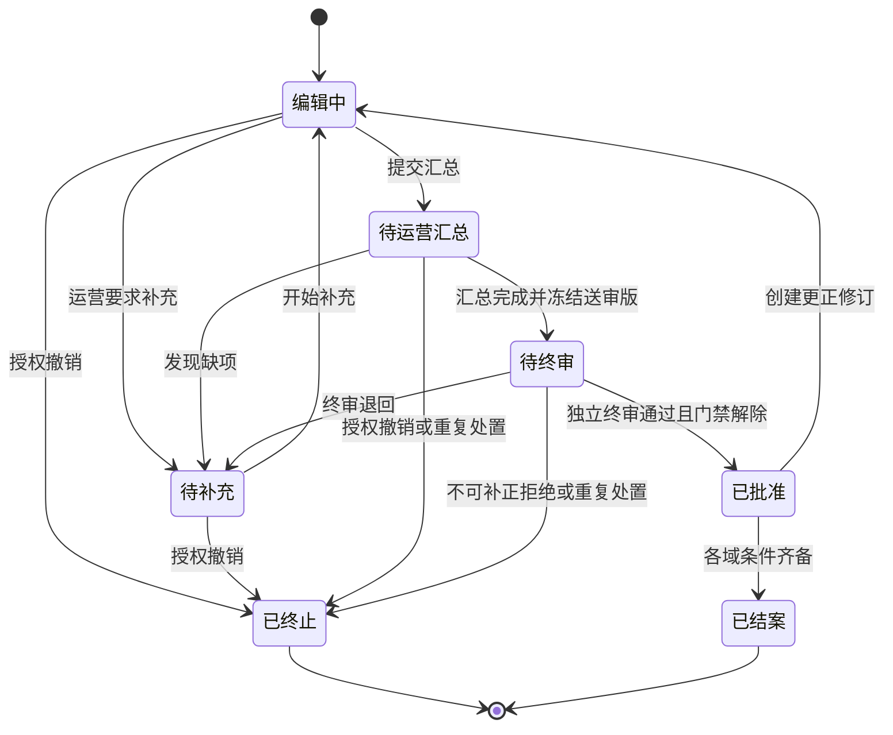
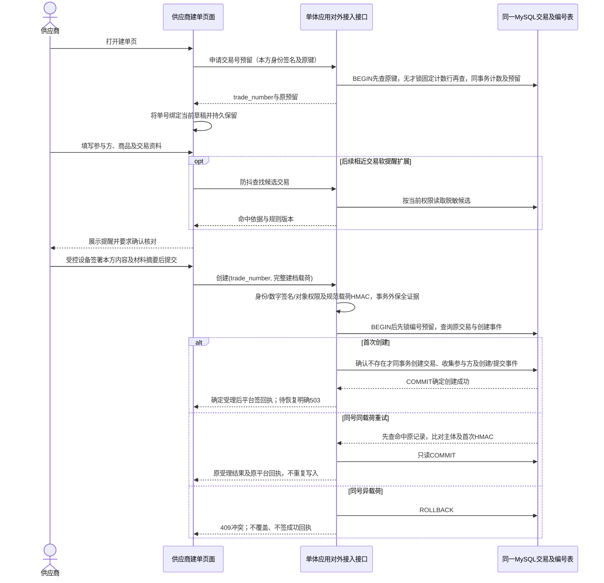
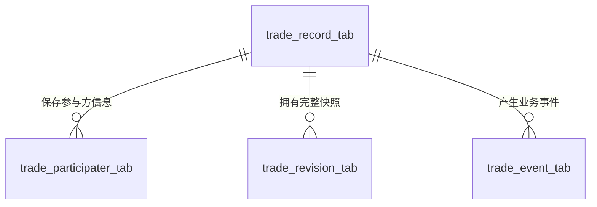
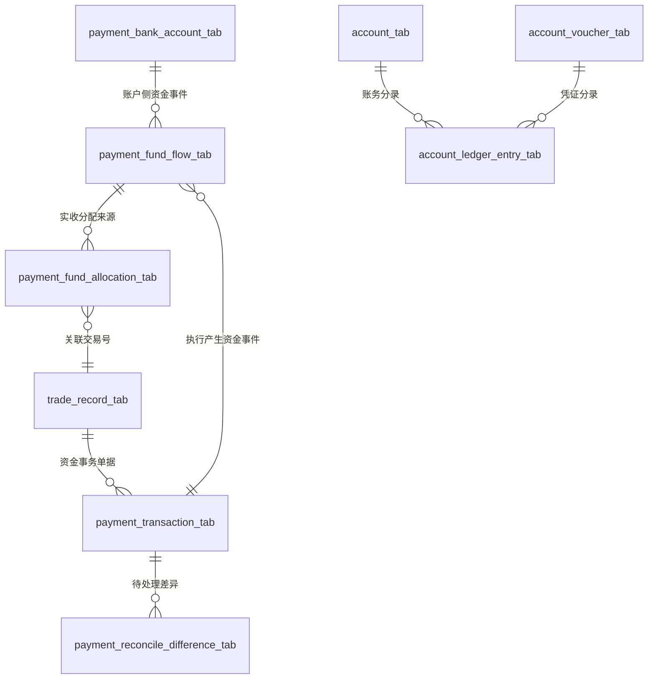

# 领域拆分评估与交易、资金账务域设计

> **状态：** 评审稿
> **范围：** 评估代理出口业务领域边界和交易生命周期；完整实体、码表及状态机已合并至[主方案数据库设计](../交付成果/代理出口业务流程图.html#database-design/trade)和[状态机设计](../交付成果/代理出口业务流程图.html#state-design/trade)，唯一数据源为`交付成果/assets/domain-model.js`。原领域HTML仅保留入口，不代表已实施的数据库或服务。
> **依据：**《金融账务系统数据库规范手册》及《资方展示产品功能原型设计》中的代理出口建档、四流协同、资金核验、报关和退税流程。

本机已建立当前领域模型的MySQL空表，并准备S3、扫描、监控/日志及调度后台用于方案验证；连接入口、验证命令及尚未实现的业务能力见[方案验证中间件环境说明](方案验证中间件环境说明.md)。本机部署不改变本文的逻辑设计评审状态。

## 0. 本轮确认的设计基线

- **仅人民币**：所有币种列/JSON只接受 `CNY`，金额 `DECIMAL(20,2)`；CNH仅保留为离岸人民币/银行路径描述。不建汇率、兑换、多币种、授信、垫资或透支能力；原始材料中的报价/结汇表述保留原件，不推导系统执行换汇。
- **逐交易签约**：每trade、每必需协议用途一份合同身份，更正/补充走原合同新版本。部分公共协议允许一次签署、明确主体/用途/有效期间复用，必须逐单引用确切签署版，不自动免除逐单协议。
- **三种资金位置**：D货款仅使用受限、可用、付款锁额。D承担固定人民币300元服务费，仅在首次获批分账时从D已核验可用余额一次性结算；不按本金比例收费，不触发于INVOICE申报，且不减少A合同应付。银行实际费用按凭证列示。
- **持久化终态**：交易终止/结案、合同被替代/终止、资金单完成/拒绝/取消/被替代、分配撤销、差异关闭及凭证失败/冲正均须有受控码和原子写入的依据。技术创建失败无业务行，银行未知不是失败。
- **精简取舍**：主表审核结果由事件派生；合同只保版本生命周期；资金单一号一版，修改新号并明确替代；流水/事务不存需回填的单值凭证号。保完整批准/付款证据、HMAC、必要资金并发投影、分录余额历史。
- **收费设计基线**：仅收固定人民币300元服务费，由D承担，在贸易核验、可用余额确认及D授权齐备后，于首次获批分账时按trade唯一键从可用余额一次性结算；INVOICE申报、补件、改版不触发收费。取消按实收本金计费，不产生比例抽佣事件；服务费不得作为A合同应付扣项。原代理合同模板须正式修订并留存D收费依据及扣收授权；银行和中转费仍按实际凭证单列、依合同承担。

本文件和主方案数据库/状态机页为修订后的逻辑设计；主业务流程、其他可交互原型、原始材料和通用数据库规范不因此被宣称同步实施。首次提交建单、结案不可重开、无垫资等与保留流程的差异见设计页。沿用手册金额、悲观锁、幂等和追加写铁律，分录采用其允许的更严格纯追加方案；手册残留乐观锁示例不作为本方案依据。

## 1. 结论

**七个领域作为第一版能力清单基本合理，但还不是完整的领域地图。** 它把核心业务对象、通用技术能力和治理能力放在同一层，且“交易档案”“资金流水”“业务用户”等名称没有说明谁拥有权威数据。建议保留并重定义原有领域，同时补齐合同/单证、物流、报关、税务、合规、通知和报表等上下文；外部连接由适配器/网关实现，不另建集成业务实体。领域/限界上下文是业务边界，不等于服务、团队或数据库；初期采用模块化单体即可。

核心调整：

1. 将“交易档案”提升为**代理出口交易域**：管理一笔出口业务从建档、审核、执行到结案的业务事实和生命周期；不拥有银行账务、合同正文、单证原件、外部监管回执。
2. 将资金账务明确成两个逻辑上下文：**资金运营/支付**负责来款分配、核验状态、结算申请及银行流水匹配；**账务核心**负责账户余额、凭证和不可变分录。可暂由同一资金域团队维护，但交易状态不能代替账务状态。
3. 将“业务用户”与“系统用户角色”明确区分：前者是本笔交易的参与方快照，后者是能登录系统的身份、组织、角色和授权。V1 暂不单独设计跨交易主体主档，登录账号也不是交易参与方。
4. 将“任务域”定位为任务编排和执行基础能力；任务只是业务流程的执行载体，交易审核、付款审批等业务状态仍由所属领域持有。
5. 保留独立审计域，但审计日志是治理证据，不代替交易事件、资金流水或审批记录。

## 2. 对现有拆分逐项评估

| 当前领域 | 判断 | 建议边界与需要明确的事项 |
|---|---|---|
| 交易域（交易档案） | **必须扩展定义** | 以一笔代理出口业务为核心，拥有创建即分配的交易业务单号、交易主表、参与方信息、完整版本快照及交易生命周期；出运批次归物流履约上下文。合同、资金、报关、退税是关联上下文，不应塞成交易主表字段或由交易域代写。 |
| 资金账务域（账户、资金流水） | **方向正确，但概念偏宽** | 区分支付/资金运营状态与账务事实。账户余额、凭证、分录由账务核心写入；资金核验、匹配及结算意图由资金运营管理。银行流水事实不能因交易档案状态变更而覆盖。 |
| 用户域（业务用户） | **不宜作为独立主档域** | V1 供应商、出口代理、实际收货人、付款方、物流公司、出口报关代理及联系人信息由交易域 `trade_participater_tab` 保存为交易时点快照；不作为跨交易权威主档。若未来需要跨交易统一识别、关系管理和复用，再单独引入主体主数据域。 |
| 系统用户角色域 | **合理且与业务主体分开** | 管理登录身份、组织、角色、权限、授权范围、职责分离和有效期。交易域可保存操作者引用，不拥有账号凭证或 RBAC 规则。 |
| 配置域（系统银行账号等） | **需按数据所有权拆分** | 全局字典、区域、系统参数归系统配置；银行账户及账户用途属于资金域；合同模板归合同域；业务规则由使用该规则的领域拥有。配置域不能成为任何团队都可读写的“共享杂物表”。 |
| 任务域（任务跑批） | **合理的支撑上下文** | 仅保留任务定义 `batch_task_tab` 与逐次执行记录 `batch_task_execute_log_tab`；每次尝试追加一条执行记录，不另建 attempt 表或任务实例表。跑批产出的业务结果仍由对应领域事务化写入；任务成功不等于交易、付款或账务成功。 |
| 独立审计域 | **合理，需与业务历史区分** | 保存操作者、动作、前后变化摘要、来源、结果和追踪标识，采用追加写、最小权限和脱敏。交易状态事件、审批结论、账务分录仍分别由交易、审批/业务、账务域作为权威事实。 |

### 2.1 当前划分中缺少的业务上下文

- **合同与单证**：合同版本、审签、签署件、单证元数据、原件存储和版本摘要。交易域只引用文件/合同标识和经审核的关键字段快照。
- **物流、报关与税务**：物流批次、报关草稿/申报回执、放行、更正、退税申请/补正/到账跟踪。可先作为交易运营域下的模块，之后按规则复杂度和团队责任拆成独立上下文。
- **合规与差异处置**：主体关系、筛查证据、四流校验、命中复核、暂停/解除和异常关闭条件。不能只依赖“独立审计”记录，也不能把合规结论压成交易上的一个布尔值。

这不意味着现在需要新增三套微服务。建议先明确它们的数据所有者和接口；交易主表与参与方信息表只承载交易建档本身的字段，不应汇总合同、物流、资金、关务等子域的权威状态。

### 2.2 建议的完整领域地图

下表描述**逻辑限界上下文**和权威数据归属，不要求一项对应一个微服务或数据库。核心业务上下文应先落实数据所有权；支撑上下文可在早期合并实现，但不能因此混淆权威状态。

| 层次 | 建议上下文 | 权威数据与职责 | 明确不负责 |
|---|---|---|---|
| 核心业务 | **代理出口交易**（原交易域） | 创建即生成并贯穿全流程的交易业务单号、各业务主体和商品资料、交易建档审核、完整版本快照、交易生命周期与业务事件 | 不拥有出运批次、资金余额、合同原件、报关/税务回执及最终合规认定 |
| 核心业务 | **合同与单证证据** | 合同类型与版本、审批/签署状态、单证元数据、文件版本/摘要、材料归属与证据引用；文件二进制进入受控对象存储 | 不拥有交易整体状态；不以文件存在推定交易审核通过 |
| 核心业务 | **物流履约** | 物流委托、运输计划、提货/出运/签收事实、物流批次、承运方回执 | 不拥有报关申报结论和资金状态 |
| 核心业务 | **关务申报** | 商品申报资料、申报草稿版本、出口方确认、申报/受理/查验/放行/更正回执及授权关联 | 不替代海关判断；不以“已提交”表示“已放行” |
| 核心业务 | **税务/退税协同** | 退税资料交接、申请/受理/补正/处理状态、正式回执与到账核对关联 | 不代表税务机关审批；不把税务处理状态等同银行到账 |
| 核心业务 | **资金运营/支付** | 银行账户用途及有效期、来款与银行流水、交易/批次分配、贸易核验进度、费用、结算应付、付款指令和银行对账差异 | 不自行生成账务余额；“付款已申请/银行已回执/收款已确认”分别建模 |
| 核心业务 | **账务核心** | 内部账户类型码、单币种账面余额、凭证、不可变分录、冲正、会计日与账务对账；不提供授信、透支或贷款 | 不管理交易审核和银行渠道交互的全部流程状态 |
| 风险治理 | **合规与差异案件** | 主体/关系核查引用、筛查运行及版本、命中复核、四流差异案件、暂停/解除决定、处置证据与责任人 | 不宣称系统筛查等于法定结论；不覆盖交易、资金或监管机构的权威事实 |
| 交易内参与方快照 | `trade_participater_tab` | 记录本笔交易各参与方在交易时点的名称、身份、联系和角色资料；不管理全局主体状态 | V1 不单独设计业务主体主数据表；参与方表不作跨交易主档 |
| 安全治理 | **身份与访问控制**（系统用户角色域） | 内外部登录身份、组织成员关系、角色/权限、交易范围、字段权限、授权时限、职责分离和访问认证引用 | 不把登录人当成交易参与方；不决定业务审批结论 |
| 平台支撑 | **系统配置与参考数据**（配置域） | 区域/时区、币种/国家/业务码表、受控系统参数、配置版本与生效期 | 银行账户归资金域、合同模板归合同域、业务规则由对应业务域拥有；禁止成为无主共享表 |
| 平台支撑 | **工作流与任务编排**（任务域） | 任务定义、逐次执行记录、重试、超时、进度、执行错误和补偿触发；不建独立任务实例表或 attempt 表 | 审批/付款/申报业务状态仍归发起该流程的业务域；任务成功不等于业务成功 |
| 平台支撑 | **外部系统集成能力** | 通过适配器/网关提供银行、海关、税务等连接、验签、超时和重试能力；由所属业务上下文持有必要的业务请求号、回执引用和结果 | V1 不单独设计集成配置、消息、尝试等实体；原始报文按安全日志/对象存储策略管理，不作为新的业务权威状态 |
| 平台支撑 | **通知与待办投递** | 通知模板版本、收件人解析结果、投递/失败/重试状态、消息回执 | 不拥有审批任务和业务待办的完成状态；投递成功不表示用户已完成动作 |
| 治理与分析 | **独立审计** | 登录、权限变更、关键操作、导出、配置修改、前后摘要、操作者/来源/结果，追加写及脱敏 | 不代替交易事件、资金流水、审批记录、文件版本和任务运行日志 |
| 治理与分析 | **经营报表/只读投影** | 跨域指标定义、数据刷新水位、聚合结果、权限过滤和导出任务 | 不作为交易、资金或监管状态的写入源；纠错回到权威上下文 |

**按复杂度再评估的候选上下文：** 商品主数据/商品归类、授信与垫资、汇率与报价、渠道对账、审批策略、客户服务案件。只有出现独立规则、生命周期、责任团队或权威数据需要时再拆；在此之前归属明确的核心上下文，不为“完整清单”而预先建服务。

### 2.3 限界上下文协作图

```text
身份与访问控制 ──授权/操作者引用──▶ 所有业务上下文
交易参与方快照（V1） ──交易时点身份/联系信息──▶ 交易 ──交易/修订事件──▶ 合同与单证
                                      ├──交易/批次事件──▶ 物流履约 ──运输事实──▶ 关务申报
                                      ├──交易/批次事件──▶ 资金运营 ──记账指令/结果──▶ 账务核心
                                      ├──交易/证据引用──▶ 合规与差异案件
关务、资金 ──出口/核验结果──▶ 税务/退税协同
关务、资金、税务、合规 ──各自权威结果事件──▶ 交易只读进度投影/结案校验
工作流与任务编排 ──幂等命令/重试──▶ 业务上下文
集成适配器/网关 ──验签/传输回执──▶ 对应业务上下文校验后处理（不单设业务实体）
所有上下文 ──操作审计事件──▶ 独立审计
各权威上下文 ──只读数据/事件──▶ 经营报表
```

此图的箭头是依赖/通知方向，不表示同步数据库联表或跨域事务。事件消费者须处理重复、乱序、延迟和重放；关键命令应有幂等键及请求摘要。交易详情展示多个上下文的状态时应标明数据来源和更新时间，不能将查询投影写回成权威状态。

### 2.4 查漏补缺：必须落地的横切边界

| 容易遗漏的边界 | 应明确的规则 |
|---|---|
| 交易、批次、合同、文件、银行流水和报关单的关联粒度 | 交易可多批次；一个文件/合同版本可以关联多个业务对象时，关系要有明确类型和有效版本；一个合并来款可分配多笔交易，分配必须可追溯且不能重复占用。 |
| 主体身份与主体快照 | V1 的 `trade_participater_tab` 保存本笔交易使用时点的名称、国家、识别类型/脱敏值、角色和来源；该表不是跨交易权威主档。业务主体、联系人、登录用户仍是不同概念。未来建设主档时，主档更新不回写已审批交易。 |
| 生命周期与事实来源 | 交易、资金、账务、关务、税务、合规各有自己的状态机和事件；“已汇出、已入账、已可用、已批准付款、银行已扣款、收款人已确认”不能合并成单一支付成功状态。 |
| 版本失效传播 | 交易关键字段或合同/单证版本变化后，明确哪些审核、核验、申报草稿、结算试算和风险筛查失效；保留旧版本、失效原因、重审责任及是否允许撤回。 |
| 异常闭环 | 差额、未知第三方付款、重复回调、资料冲突和人工导入错误均应有案件/差异编号、责任人、时限、证据、复核及关闭理由；不能只写日志或自由备注。 |
| 软删除、保留与隐私 | 金融和监管证据按适用政策设保留期、访问审计及法律保全；不以级联删除清理历史。敏感字段加密、展示脱敏，日志/事件/报表不得复制明文。具体期限须由法务/合规确认。 |
| 主数据及参考数据治理 | 码表、国家/币种、汇率、商品编码、银行渠道码和业务规则必须有来源、版本、生效区间、维护者及历史重放语义；不能因字典更新重解释旧交易。 |
| 可观测与恢复 | 跨域 `trace_id`、事件/outbox 积压、失败重试、死信/人工补偿、任务水位、银行/监管回调延迟和数据对账均需监控及恢复演练。技术日志不承担业务审计。 |
| 权限与职责分离 | 经办、审核、执行、系统管理和审计查询分权；外部参与方只见授权交易/字段；导出、批量下载、临时授权和到期回收单独留痕。 |

### 2.5 原始七域到建议上下文的映射

| 原始提法 | 完善后的归属 |
|---|---|
| 交易档案 | 代理出口交易；合同/单证、物流、关务、税务、合规分别成为关联上下文，不塞入交易主表 |
| 资金账务（账户、资金流水） | 拆为资金运营/支付与账务核心两个逻辑上下文；初期可同一模块群实现 |
| 用户（业务用户） | V1 交易参与方身份与交易时点信息归 `trade_participater_tab`；不另建全局主体主档表。若后续需要跨交易主体统一核验、关系管理、主体状态及资料复用，再独立引入主档并由参与方表引用，同时继续保留交易快照 |
| 系统用户角色 | 身份与访问控制 |
| 配置（系统银行账号等） | 参考数据/系统配置与资金账户主数据分开；模板和业务规则回归所属域 |
| 任务（任务跑批） | 工作流/任务编排；业务审批和领域状态仍由业务上下文持有 |
| 独立审计 | 独立审计；与交易事件、审批记录、账务流水、技术运行日志分开 |

### 2.6 数据库规范的适配事项

现有数据库手册的“7 个业务域”词表是封闭的，且规定单域表数不超过 5；它是数据库命名/归属规则，**不等同于完整业务限界上下文清单**。实施前需评审：

1. 将代理出口交易的 `trade` 纳入数据库域词表，并明确它与现有 `payment` 支付交易的命名区别。
2. 决定合同/单证、关务、物流、税务和合规表的域前缀及表数上限；不能为满足上限把不相关权威数据塞入 `trade`。
3. V1 不单独设计 `party` 主体主档；`trade_participater_tab` 保存本交易参与方快照。若后续出现跨交易主档复用、统一识别/关系核验需求，再评审 `party` 主档及与参与方快照的引用关系。
4. 若资金运营与账务核心分别维护，确认 `payment` / `account` 的边界、跨域业务号和凭证关联方式。
5. 交易业务单号在建档创建时生成，批准前后沿用同一编号；不需要另设待生成的预下单编号或为此放宽 NULL 策略。
6. 审核每个上下文的字段命名、状态码表、公共字段/追加写例外、敏感信息分类、唯一索引和跨域引用，不从本文逻辑模型直接推导生产 DDL。

### 2.7 端到端业务交接与权威状态

| 阶段 | 主责上下文 | 主要交接/事件 | 不可混淆的结果 |
|---|---|---|---|
| 主体建档与交易申请 | 交易参与方快照、身份与访问控制、代理出口交易 | 交易时点主体资料；经授权参与方填报；交易创建/提交事件 | 参与方资料不构成全局主档；登录授权不等于交易角色授权 |
| 合同与单证审核 | 合同与单证证据、代理出口交易 | 合同/材料版本及审核引用；关键字段变更通知交易域重新评审 | 文件上传不等于材料审核通过；合同签署不自动批准交易 |
| 物流与申报 | 物流履约、关务申报 | 交易批次 → 运输计划 → 运输证据 → 报关草稿版本/出口方确认 → 正式申报及回执 | 报关草稿确认、申报受理、查验和放行是不同事实；回执由关务上下文持有 |
| 来款及资金核验 | 资金运营/支付、账务核心、合规与差异案件；银行适配器提供传输能力 | 原始银行流水先幂等接收；银行确认实际入账后按账务规则记入受限/不可用资金；匹配、分配、贸易背景核验和银行可用确认后，再按账务指令释放或划转；差异转案件 | 付款方汇出、银行入账、银行核验、资金可用、账务记账不能互相推定；“不可用”须映射真实账务状态，不能只存在交易域标记 |
| 费用与供应商结算 | 资金运营/支付、账务核心、身份与访问控制 | 生成应付/费用计算、职责分离审批、付款指令、银行结果、记账凭证及分录 | 内部审批不等于银行执行；银行扣款不等于收款方到账确认；冲正新增反向事实 |
| 退税与结案 | 税务/退税协同、代理出口交易、资金运营/合规 | 关务/资金事实供退税材料引用；正式处理/补正/到账关联；交易结案门禁读取各域最终结果 | 税务处理不等于退税到账；交易可展示聚合进度，但不能改写各域权威结果 |

以上顺序允许业务分支和并行处理，不能硬编码成单一全局状态机。每次跨域交接都应明确：发起命令方、权威写入方、引用标识、幂等键、成功回执、超时/重试策略、人工补偿责任人及下游版本失效规则。外部机构/银行返回的状态以其正式回执及适用业务规则为依据，不由系统自行推定。

## 3. 交易域上下文定义

### 3.1 聚合根与边界

**出口交易是代理出口核心域的聚合根。** 当前交易建档事实由 `trade_record_tab` 主表和 `trade_participater_tab` 参与方信息表共同承载；完整建档版本快照和业务事件分别追加保存。合同/单证、物流、关务、资金、税务和合规是围绕同一交易业务单号协作的业务子域，各自拥有其状态和事实，不共享交易内部事务，也不由交易域代写。

交易业务字段严格来自原型§4.1交易建档内容：供应商、出口代理（字段命名使用 `export_agent`）、实际收货人、付款方、物流公司、出口报关代理及其完整填报信息，以及运营汇总、待补、人工核查和终审结果。参与方资料与交易生命周期状态分表；字段细目以[领域实体设计方案](../交付成果/代理出口业务流程图.html#database-design/trade)为准，不增加未由交易建档采集的交易性质、内部组织、业务日期或其他臆测字段。出运批次及商品分配由物流域拥有；文件二进制、合同正文及文件版本元数据由合同/单证域拥有。业务对象直接引用所属业务确认的最终文件版本，不设通用多态绑定表；材料审核状态由各自业务域维护，不存在与业务无关的全局审核状态。文件历史可留存，后续更正以新文件版本和业务对象的新版本引用留痕。

### 3.2 聚合不变量

| 聚合 | 根实体 | 主要成员 | 必须保持的不变量 |
|---|---|---|---|
| 交易聚合 | `TradeRecord` | 交易主表、参与方信息、完整版本快照、交易业务事件 | 创建时生成唯一业务单号并贯穿待审与批准后；送审/批准快照不可覆盖；状态转移合法；跨域通过业务单号引用。 |
| 资金聚合 | 资金域所有 | 来款、分配、核验、结算、银行流水 | 每笔资金事实可追溯且幂等；可用状态以银行事实为准；交易域不能直接更改资金状态。 |
| 合同/单证聚合 | 合同/文档域所有 | 合同版本、文件、审核及签署信息 | 文件历史版本可留存；各业务实体直接引用所属业务确认的最终文件版本，不能静默替换。文件最终确认与该用途的材料审核是不同概念，审核状态由业务所有者维护。 |

参与方资料写入 `trade_participater_tab`，交易状态和其他建档字段写入 `trade_record_tab`；两者通过交易根记录和修订号保持一致。状态转换、版本快照和业务事件在一个短本地事务内提交；参与方表不维护填报/审核/待补/批准等状态。禁止把银行调用、文件上传或报关提交放进交易数据库事务；跨域交接使用幂等事件/命令。

### 3.3 实体模型精简审计

本轮按字段是否有独立业务含义、权威来源和审计用途逐项复核；删除可由现有稳定标识/记录确定性推导的重复数据，不删除能还原历史事实的快照、版本或事件。

| 精简项 | 处理及依据 |
|---|---|
| `evidence_binding_tab` | 删除。其 `owner_context_code + owner_business_number` 是数据库无法约束的多态关联；交易、合同版本、税务/关务提交等业务对象改为直接引用文件逻辑号及版本。用途审核状态归对应业务实体，不建立全局审核状态。 |
| `contract_type_code` | 不以“只有跨境贸易”为删除依据。复用扩充后的 `document_type_code` 表达销售/代理/物流/报关协议、授权、B付款发票等用途，不再新增同义分类字段。 |
| 参与方 `party_reference` | 删除。V1 不建全局主体主档，保留一个不可解析的主档引用没有实际目标；跨域引用本交易参与方使用交易号、角色码和参与方序号。 |
| 参与方 `trade_number` | 删除。该行已有 `trade_record_id` 指向所属交易根，重复保存业务号会形成双写一致性风险；跨域仍使用交易业务号。 |
| 参与方 `contact_details_json` 及角色信息中的联系人引用 | 删除。已有联系人姓名、电话、邮箱列，JSON 再存联系人会重复权威数据；`settlement_contact_reference`、`service_contact_reference`、`delivery_contact_reference` 也没有独立联系人主档可解析。V1 仅建模一组主联系人，如确认需要多联系人再独立评审。 |
| 合同参与方及有效期 | 移至合同版本；逐单以批准交易快照+角色/序号解析主体，不重复复制名称；公共协议无单一交易时保可核验法定身份快照。签署事实由最终签署件支持，不存无法解析的签字人主档引用。 |
| 文件 `previous_file_id` | 删除。普通版本顺序已由逻辑文件号和递增版本号确定；保留 `supersedes_file_id` 仅记录正式更正所替代的已确认版本。 |
| 合同修订 `content_hash` | 删除。同一合同文件版本的字节摘要已由 `document_file_tab.sha256` 保存，不重复存哈希；保留文件版本引用和签署/审核事实。 |
| 交易事件 `evidence_reference` | 删除。事件类型载荷已支持 `evidence_references` 数组；保留统一标量列会导致单条与多条证据两套入口。 |
| 税务案件 `customs_evidence_reference` / `funds_evidence_reference` | 删除。对应提交版本的 `evidence_manifest_json` 统一冻结文件版本及摘要，案件不再另存不带版本语义的重复引用。 |
| 物流/关务中的主体主档引用 | 删除未建模的 `carrier_reference`、`shipper_party_reference`、`consignee_party_reference`、`exporter_party_reference` 和 `agent_party_reference`；统一用交易号、参与方角色码和序号解析交易时点快照。 |
| 银行账户 `owner_party_reference` | 删除。V1 不建全局主体主档；账户持有人名称及核验依据保存在核验快照中，避免保留不可解析的主体引用。 |
| 合规筛查 `subject_reference` | 删除。筛查对象改为明确引用交易修订中的参与方角色和序号，避免筛查结论落到不可解析的主体主档引用。 |
| 资金事件 `balance_before` / `balance_after` | 删除。余额是事件/分录可重建的投影，流水只保存发生金额和资金位置转换，避免将快照误作权威余额。账务分录的 `balance_after` 保留为逐笔记账历史证据。 |
| 对账差异 `difference_amount` | 删除。仅保存银行侧和内部侧金额；差额由两者计算展示，避免三份金额数据漂移。 |
| 凭证 `transaction_number` | 删除。来源由 `business_type_code + business_number` 统一定位，重复列没有独立语义。 |
| 分录 `account_number`、`business_type_code`、`business_number`、`entry_status` | 删除。账户业务号可由 `account_id` 关联获取；来源业务由 `voucher_number` 关联获取；分录仅在成功记账时创建，生命周期状态由凭证统一管理。 |
| 审计日志 `changed_fields` | 删除。允许记录的字段变化可由脱敏的 `before_data` / `after_data` 比较获得，不重复持久化字段名清单。 |
| 银行账户核验快照中的状态码 | 删除。当前核验状态已在 `verification_status` 列，快照只保留核验时间、核验人和依据。 |

主方案实体清单仍为 **14 个逻辑上下文、45 张实体表**，四域15表；本轮不为减少表数合并不同生命周期。主表审核JSON、合同主状态及独立审查/签署双状态、资金事务版号、事务/流水单值凭证号和分配核验累计列不再重复维护；新增必要的执行门禁/历史和公共协议版本载体，不承诺机械减列比例。文件 `sha256`、创建HMAC、版本HMAC与命令摘要用途不同，不合并。

按主方案显式字段拆分、公共字段组逐名计数，本轮四域为交易58、合同43、资金96、账务39，共236列（评审基线234）；JSON根字段19（基线17）。净增来自补齐闭环/历史，而非把删列藏入JSON后声称总量下降；表数不变，状态减少重复含义但增加真正终态。

## 4. 交易生命周期与命令

### 4.1 交易建档状态机

交易状态按业务责任合并近义阶段，并补终态；主方案领域模型的 `trade_status_code` 是唯一现行码表：



创建即进入2编辑中；3待补充合并运营待补/终审退回，4待运营汇总、5待终审、8已批准保持职责差异，9已终止、10已结案持久化。旧码1/6/7只读兼容，不复用改义；尚无生产数据迁移授权。终止事件明确原因1撤销/2不可补正拒绝/3重复及授权人/证据，与主状态同事务提交。已批准履约中不得用取消消除义务；结案读取各域最终事实，特殊结案另有授权。

暂停为未解除案件集合形成的正交门禁，不写入主生命周期，不再覆盖/恢复“暂停前状态”。解除一个案件不解除其他原因；门禁不可确认时不得批准、付款或结案。首次终审退回补充不要求已有批准版；批准后更正才要求旧批准版。创建失败只留请求审计，不制造失败交易行。

完整快照本身是不可变记录，不承载可变工作流状态；在提交终审、批准和批准后更正等节点分别留存快照，具体审核结果由交易状态和业务事件表达。事件类型和交易状态码使用主方案预先定义的码表，不使用数据库 `ENUM` 或自由文本。

### 4.2 命令与相近业务提示

建档命令执行访问授权、创建幂等、状态合法性、交易建档必填项及审核职责分离校验。批准命令应对送审完整快照作终审确认，并原子写入批准版本、状态和事件；失败不得返回成功。审批前后均按 `trade_number` 定位，不暴露自增主键。

在运营配置的时间窗内，基于已填写的主体、商品、实际收货人、付款方及金额/币种等资料查找相近交易建档，向运营提醒并记录候选业务单号、命中字段、规则版本、人工核对人和结果。时间窗长度及匹配阈值不预设；提示不自动阻断或合并，也不替代运营核对或人工终审。

### 4.3 建单页面与后端防重

**防重分两层，不能把相似业务提示误当成接口幂等：**

1. **技术防重（强保证）**：供应商打开建单页时调用交易单号生成器预取 `trade_number`，将单号绑定当前建单草稿并在页面恢复时沿用；该业务号同时作为创建幂等键。预取号不创建交易，供应商首次提交在同事务创建交易及其收集的全部资料；无运营先建单/邀请。提交按钮防连点并展示处理中状态；提交超时或断网时保留原单号和原始请求，不另取新号、不自动重新组装请求。页面通过按单号查询创建结果进行恢复，或使用同一单号和同一请求载荷重试。
2. **业务防重（软提醒）**：主体、单据编号、收货人、付款方、商品及金额币种等关键资料输入完成后，页面防抖调用相近交易查询；展示脱敏候选号、命中依据和候选状态，允许有权限者查看。提交前再次查询以避免旧提示；用户核对后可继续创建并记录人工核对结论。匹配服务异常时明确显示“未完成查重”，不得显示“无重复”；是否继续按运营授权策略处理并留痕。相似单提醒不自动合并，也不以相似度替代人工判断。



**后端原子性与响应规则：**

- `trade_number` 由服务端单号生成器产生、具备足够唯一性；`trade_record_tab.trade_number` 建唯一索引，创建请求无需额外 `creation_request_number`。预取失败或用户放弃会产生号码空洞，号码不回收复用。
- 当前步骤一API以[独立HTTP接口协议](步骤一HTTP接口协议.md)为准：`POST /api/v1/trade-number-reservations`预取号；`POST /api/v1/trades`首次提交并创建，`Idempotency-Key`与正文`tradeNumber`一致；`GET /api/v1/trades/{trade_number}`恢复。付款方POST自己的资料，双方修改PUT原资源并带强If-Match；不使用旧动作路径。相近交易提示属于后续扩展，不是本轮额外提交/审批用例。
- 创建服务先做身份及编号预留归属核验，再按`S1-HTTP-C14N-2`对类型化请求、HTTP方法/路径/原If-Match规范化；HMAC-SHA256及密钥版本持久化。数组保序，不含请求时间、trace id、令牌等传输元数据；重试必须原键原文。
- 在单个本地事务中先锁编号预留并查询原交易/事件；已有先核对主体及首次HMAC回放，不存在才插入交易根、供应商收集参与方、创建事件1和提交事件3并消费确认。唯一键冲突只是兜底，回滚后新事务先查；异文409，不覆写。供应商无需设备/自管私钥，事务前保全实名/强认证/原意图确认的受控`operation_evidence_reference`；机构自选签名才用`signing_evidence_reference`，平台COMMIT后签受理回执不是用户签名。HTTPS单独不能证明抗抵赖，合同另走第三方实名电子签。文件/证据自动恢复见专门可靠性设计。普通资料提交不造完整快照。
- 页面超时后先以原 `trade_number` 查创建结果；若已创建则导航到该交易详情。查不到时才以原号、原载荷重试。若用户修改了载荷，先明确确认上一请求未创建，再提交新载荷；同号异文冲突时恢复既有记录或显式放弃原草稿并重新取号，不能静默换号重提。
- 创建时在服务端再运行一次相近交易检查，并将候选号、命中字段、规则版本及用户选择写入既有 `trade_event_tab` 事件载荷。相似检查只提供人工提示；并发下不同 `trade_number` 的相近交易仍可能同时创建，这是软提醒的边界。若未来要硬性禁止某类重复，须先定义无歧义的业务唯一键，再在数据库上增加相应唯一约束，不能用相似度或 HMAC 猜测唯一性。
- 每次重放仍执行认证与对象级授权，不得仅凭可预测或泄露的 `trade_number` 返回业务数据。HMAC 仅用于创建请求内容比对，不是访问凭证；密钥版本应在幂等重试有效期内可用于验证。
- 相近交易候选查询以供应商/出口代理、供应商单据编号、实际收货人、付款方、商品名称规格及金额币种等信号按配置规则检索；响应仅含调用方有权查看的脱敏候选和命中原因。创建服务提交前重新执行同一规则并记录规则版本和人工核对结论，不能信任页面传回的“无重复”结论。

## 5. 交易域实体模型（建议稿）

> 本节保留交易域设计依据与不变量；跨域一致的实体字段字典以[领域实体设计方案](../交付成果/代理出口业务流程图.html#database-design/trade)为准。

本节仅定义**代理出口交易上下文**的权威实体。数据库手册现规定业务域词表封闭、每域实体表不超过 5 张；`trade` 尚未登记，因此表名前缀、域词表新增及 DDL 均需先经规范评审。当前模型共 4 张 `trade` 域表；物流批次、文件关系、合规案件、审批策略和 outbox 不重复塞入交易域。

### 5.1 实体关系与聚合边界



`trade_record_tab` 是交易聚合根，保存业务单号、唯一交易生命周期、版本指针，以及商品、来源/待补和文件引用；审核结论由本修订事件派生，不再保存主表审核结果JSON。参与方信息拆到 `trade_participater_tab`，包含A–F角色、主体身份、注册地址、主联系人及角色专属信息；送货地址与注册地址分别表达，不设参与方状态，也不建全局主体主档。参与方更正提升交易修订，旧版由完整快照还原。商品仍为主表JSON，不另建商品行表。

`trade_revision_tab` 保存包含主表与所有参与方信息的完整不可变快照；`trade_event_tab` 追加保存交易状态和业务事件。物流上下文按交易业务单号、交易修订号和商品序号关联后续出运批次及分配；合同/单证上下文拥有文件和证据关系。跨域使用稳定业务单号，不复制其他上下文的权威状态。

**主表与参与方信息表边界和事务取舍：**

- `trade_record_tab` 保留交易编号、状态/版本、商品、来源/待补、文件引用及维护字段；审核结果由事件派生。金融/交易事实无软删除释放编号能力。
- `trade_participater_tab` 按交易和角色存一条或多条参与方资料，不管理任何状态；主体名称、地址、联系信息等字段按跨境长名称/地址适当扩大长度，角色专属资料放结构化 JSON。高敏识别信息加密存储，外部/内部读写按角色和字段白名单授权。
- 商品集合使用有结构约束的 JSON 数组，只包含交易建档采集的商品名称、规格、数量、单位、货值、币种、原产地和产品资料引用；商品序号在不可变交易修订内确定，物流/关务以交易修订号和商品序号关联，不另建交易商品表。需高频筛选的字段由派生索引或只读查询投影承载，不另建第二个权威写模型。
- 按唯一 `trade_number` 锁定交易根并用 `revision_number` 和幂等键拒绝旧版本覆盖；参与方资料变更与主表修订号维护、完整快照和事件在一个短本地事务内提交。该事务只覆盖交易域数据。
- 文件上传、资金操作、工作流引擎及其他领域写入不得加入该事务；使用异步交接、幂等消费和明确失败状态。
- 交易状态是交易建档生命周期；合同、资金、关务、税务和合规状态各由其所属上下文持有。

### 5.2 实体清单与交易建档字段边界

| 实体 | 表名建议 | 当前职责 |
|---|---|---|
| 出口交易聚合根与主表 | `trade_record_tab` | 唯一交易号/生命周期、版本指针、商品/来源/待补及文件引用；首次请求HMAC用于幂等，不存重复审核结果 |
| 交易参与方信息 | `trade_participater_tab` | 按交易和主体角色保存主体引用、法定名称、身份/联系资料及角色专属业务信息；不管理状态 |
| 完整建档版本快照 | `trade_revision_tab` | 交易建档完整 JSON 快照、HMAC-SHA256 校验值/密钥版本和快照原因 |
| 交易业务事件 | `trade_event_tab` | 追加记录建档创建、资料提交、运营汇总、终审、暂停/解除及相近业务人工核对 |

**字段准入：** 主表只收录原型§4.1中不属于参与方信息的字段；参与方信息表角色码使用完整业务名称，英文角色字段使用 `export_agent` 表示出口代理，不使用缩写或阶段编号。参与方名称、地址、联系方式等字段长度适当增大，完整类型和结构见[领域实体设计方案](../交付成果/代理出口业务流程图.html#database-design/trade)。批次、关务申报要素、资金事实、合同/文件正文和工作流任务归各自上下文。

### 5.3 交易编号、流程状态与事件

交易单号列统一使用 `VARCHAR(128)`，这是容量上限；生成器仍按固定格式产生实际业务号，不填充到 128 位。交易单号生成器可在填报前预取唯一 `trade_number`，真实创建成功后沿用该号；不另设预下单业务号或 `creation_request_number`。创建命令直接以 `trade_number` 作为幂等键：同一单号和相同规范化创建载荷重试时返回已创建交易；同一单号但载荷不同则返回冲突，唯一索引保证最多创建一笔。主表保存首次创建载荷的 `creation_payload_hmac` 及密钥版本，供同号重试比对；它不是授权凭证，也不应拿可变的当前交易内容来代替首次请求。若单号生成请求自身需要重试，生成器可接受独立的请求幂等键以返回同一单号。未完成创建的预取号码允许形成号码空洞，不复用。

交易现行状态为 `编辑中、待补充、待运营汇总、待终审、已批准、已终止、已结案`，合法跳转见§4.1及主方案状态机；暂停门禁独立。主状态与终态事件原子提交，当前审核/待补视图由事件派生；不把合同、银行、账务事实写成交易状态。

在运营配置的时间窗内，基于已填写的主体、商品、实际收货人、付款方及金额/币种等资料查找相近交易建档，提示运营核对并记录候选业务单号、命中字段、规则版本、核对人和结论。时间窗长度及阈值不预设；提示不自动阻断、合并或代替终审。记录相近业务提示和人工核对事件，核对结果使用受控码表。

### 5.4 版本快照、hash与最终付款留档

`trade_revision_tab` 若只存 `revision_content_hash`，既不能还原审批人当时看到的内容，也不能独立复核或证明字段差异，因此单独存 hash 的审计价值不足。应保存规范化后的**全量交易建档快照**，并以密钥管理的 HMAC-SHA256 校验其完整性；快照记录校验密钥版本。为控制体量，可不保存每次未提交的键入过程，但至少在提交人工终审、批准和批准后创建更正版本时写入不可变快照，并保留操作者、时间、状态和触发事件引用。快照含敏感字段时应加密并严格授权，且在快照保留期内保留受控验证能力，避免低熵敏感数据遭离线猜测。

最终打款时可以再保存一份付款时点的全量交易快照，作为资金事务的执行依据和事后核对证据；由资金事务/付款记录引用已批准的交易版本，并保存快照版本号、HMAC、密钥版本、打款业务号和银行执行关联。该快照只能证明打款时采信的内容，**不能替代交易提交/批准时的快照**，因为它无法证明此前审核过什么，也无法覆盖多个付款时点、拆分付款和后续更正。敏感信息应按资金执行的必要范围最小化、加密并严格限制读取。

### 5.5 外部填报与内部运营的安全边界

外部与内部是同一交易聚合的两种授权视图，不是两个可相互冒用的账号或业务号：

| 控制面 | 外部业务主体填报 | 内部运营/审核 |
|---|---|---|
| 入口与身份 | 独立外部API/页面；供应商与付款方分别实名核实法定主体，不依赖运营邀请 | 企业身份平台登录，建议强认证/多因素认证 |
| 授权范围 | 供应商本人编号预留/交易归属；付款方身份与指定交易关系独立核实；逐对象/角色/字段校验，供应商声明不是访问授权 | 按组织、岗位、交易范围、操作类型及职责分离授权；本轮内部协议只读概览，不代建单/代填 |
| 数据范围 | 服务端逐请求校验业务单号对象权限；仅读写该主体获准字段，拒绝越权修改其他主体资料 | 按职责查看完整建档、材料来源、待补项、差异和审核记录；终审人与提交人分离 |
| 响应与存储 | 外部 DTO 使用字段白名单，不返回内部备注、风险命中、审核意见、其他主体敏感资料或内部主键；外部应用不得直连交易数据库 | 内部视图按最小权限展示；敏感识别号/联系方式加密存储、展示脱敏、解密单独授权 |
| 防护与审计 | HTTPS、速率限制、错误响应避免泄露业务单号存在性；当前访问可撤销并记录访问，不以猜到单号放行 | 所有查询/导出/审批留痕；拒绝默认公开文件路径、内部自增主键和原始审计载荷 |

`trade_number` 是业务定位号，不是密码、令牌或授权凭证；高熵随机编号只能降低枚举风险，不能替代认证、对象级授权和每次操作的字段级校验。前后端隐藏字段不能代替服务端授权。完整实施仍需由身份平台、API网关、密钥管理、数据库权限和审计域共同落实。

## 6. 跨领域协作与事件

### 6.1 交易域发布的业务事件

事件类型使用[领域实体设计方案](../交付成果/代理出口业务流程图.html#database-design/trade)中固定的 `trade_event_type_code`，覆盖交易建档创建、资料提交、补充资料、运营汇总、人工终审、退回、暂停/解除、批准以及相近业务提示和人工核对。事件载荷包含事件号/类型、唯一 `trade_number`、建档版本号、操作者引用、发生时间、追踪标识和必要的最小业务差异；不包含敏感证件或合同正文。消费者按稳定事件号幂等处理，延迟或重复事件不得触发重复付款、申报或建档。

### 6.2 依赖与责任矩阵

| 事项 | 权威数据所有者 | 交易域的做法 |
|---|---|---|
| 交易参与方快照 | 代理出口交易域 | 参与方资料直接保留在本交易快照中；V1 不单独设计跨交易主体主档 |
| 系统登录身份与授权 | 身份和访问控制域 | 保存操作者引用；服务端每次命令校验权限，不相信客户端传入角色 |
| 合同签署版本、原始单证 | 合同/文档域 | 保存引用、版本号和必要摘要；关键变化触发交易重新评审 |
| 银行账户、原始流水、可用资金、会计分录 | 资金运营/账务核心域 | 记录业务关联号并订阅权威事件；不自行推导“已入账/可用/已付款” |
| 报关、物流、退税结果 | 对应物流/关务/税务域或模块 | 关联批次和回执标识；不把“提交”映射为“已受理/已放行/已到账” |
| 合规筛查和差异处置 | 合规上下文 | 读取交易快照、发布暂停/复核结论；交易域执行自身门禁，不自行生成合规结论 |
| 操作日志与安全审计 | 独立审计域 | 传递操作者、动作、对象、结果、差异摘要和追踪标识 |
| 定时任务、重试、跑批 | 任务编排域 | 任务定义写入 `batch_task_tab`，每次实际尝试追加到 `batch_task_execute_log_tab`；任务状态不覆盖业务状态 |

## 7. API 与事务边界建议

- 对外与对内使用独立 API/DTO 和字段白名单；两者均以 `trade_number` 定位，不暴露自增 `id`，且每次请求都执行身份、对象和字段级授权校验。
- 同一交易建档的变更串行化：按规范在一个数据库事务中锁定主表根记录（唯一索引等值 `FOR UPDATE`），校验当前状态、`revision_number` 及幂等键，再写主表/参与方资料、需要的完整快照和事件。不要对整个交易链路持锁调用外部服务。
- 写接口执行“授权校验 → 幂等校验 → 状态/业务不变量校验 → 本地事务写入 → outbox 发布”；失败必须返回明确错误，并保留可追踪的失败信息。
- 外部系统回调先验签、落入对应上下文的接收记录、做幂等和状态校验，再产生业务事件；回调到达不直接等于流程成功。
- 交易域提供聚合查询/API；跨域报表通过只读投影或报表模型实现，不让交易服务依赖多域同步联表。

## 8. 实施顺序与评审项

1. **先确认上下文和数据所有权**：明确完整上下文清单、各自唯一写入方及跨域引用；V1 业务参与方信息由 `trade_participater_tab` 保存为交易快照，不另建全局主体主档；明确模块化单体中的代码/表所有权。此阶段不要求拆成微服务。
2. **再调整数据库命名规范**：评审是否新增 `trade` 域及合同/单证、关务、物流、税务、合规等表前缀；确认单域表数限制和与现有 `payment` / `account` / `customer` 的边界，避免命名词表限制破坏业务归属。
3. **先落交易主流程**：交易业务单号、各参与方的交易建档填报、商品明细、完整快照、状态机、审核职责分离和业务事件；V1 参与方资料是交易快照，不另建主体主档；批次实体及分配由物流上下文设计。
4. **再接领域事件**：通过 outbox 接入资金、合同/文档、报关/物流、税务、合规与任务系统；每个下游消费幂等并可重放。
5. **补门禁和可观测性**：明确付款方与实际收货人的关系、材料版本、异常暂停和相近业务人工核对；对非法状态跳转、重复请求、事件积压、审核超时提供告警和审计关联。
6. **最后评估服务拆分**：只有当数据所有权稳定、部署/扩展/安全边界或团队交付需要明确时再拆服务；不以领域名直接推导一域一服务/一库。

后续实现前仍需确认的规则：交易业务单号格式、相近业务检测时间窗及阈值、付款方与实际收货人关系的必填和复核规则、运输资料暂缺时的补齐时限，以及批准后更正流程。时间窗和阈值由运营配置，不在实体设计中预设。

## 9. 资金账务域实体模型（建议稿）

本节按领域地图将资金能力拆为**资金运营/支付（`payment`）**和**账务核心（`account`）**两个逻辑上下文。前者拥有银行账户用途、银行流水事实、来款分配、贸易核验、D服务费分账结算、结算、付款指令及差异处理；后者拥有账务账户余额、凭证、分录和冲正。两者可以先在同一模块化单体中实现，但不得共用一张可变的“资金状态表”，也不得由交易域直接写入。

### 9.1 聚合边界与实体清单

| 上下文 | 实体 / 表名建议 | 作用 | 可变性 |
|---|---|---|---|
| 资金运营/支付 | `payment_bank_account_tab` | 真实银行账号的不可变配置版、持有人、用途、有效期、核验及保护账号 | 配置核验后冻结；停用/核验操作审计 |
| 资金运营/支付 | `payment_fund_flow_tab` | 银行收支、三位置迁移及首次获批分账时扣减D可用余额的服务费结算事件 | 追加写；纠错新增反向事件 |
| 资金运营/支付 | `payment_fund_allocation_tab` | 银行实收与交易之间的分配关系；支持一笔实收拆分到多笔交易、一笔交易分次收款 | 受控状态投影；金额变化用新分配/撤销事件表达 |
| 资金运营/支付 | `payment_transaction_tab` | INVOICE、核验、服务费分账结算、结算、付款及正式退款单 | 一号一版；送审后修改新号，旧单授权替代 |
| 资金运营/支付 | `payment_reconcile_difference_tab` | 银行事实与资金事件/订单的差异、责任人、处理及复核结论 | 状态受控变更；处理历史留痕 |
| 账务核心 | `account_tab` | 仅CNY、受限/可用/付款锁额三类型，按受控范围及科目区分的账户实例 | 仅加锁记账更新余额，无授信/透支 |
| 账务核心 | `account_voucher_tab` | 一次账务业务的记账凭证及状态 | 记账过程受控变更；已记账后仅允许冲正状态 |
| 账务核心 | `account_ledger_entry_tab` | 按账户、方向、科目记录的不可变账务分录 | 追加写；不得改金额或删除 |

**表数与命名约束：** `account` 保持手册现有 3 张核心表；`payment` 控制为 5 张。沿用 `payment_transaction_tab` 的 transaction 语义，将其定义为**可变的资金业务事务单据**，承载 INVOICE、贸易核验、服务费分账结算、结算及付款等业务类型、状态机、审批版本和渠道执行摘要；它不是账务分录，也不替代不可变的资金事实。每次真实银行入/扣账、内部资金释放/占用仍追加写入 `payment_fund_flow_tab`；所属资金业务上下文保存必要的渠道请求号/回执引用，适配器/网关负责传输和验签，不另建集成业务实体或 `payment_order_tab`。现有 `payment_reconcile_difference_tab` 保留。新实体前缀及 payment 五表清单仍需规范评审；不得因逻辑上下文拆分而绕过数据库手册的封闭域词表和单域表数上限。

### 9.2 实体关系与权威事实



图中均为逻辑引用，不建物理外键；未分配实收不伪造交易号。真实银行配置与内部账务账户不是同一实体，账务scope使用稳定银行身份，不因配置改版重复创建同一余额。单次记账命令一凭证，一事务/事件因多个记账阶段可对应多凭证；凭证用 `business_type_code + business_number` 及命令阶段定位来源，事务/流水不存单值 `voucher_number`，不UPDATE追加流水回填记账结果。

### 9.3 资金运营/支付实体

#### `payment_bank_account_tab` —— 真实银行账户档案

一行是一真实账号的一个配置版本：`account_number`为配置版本业务号、全局唯一；`account_fingerprint + configuration_revision_number`唯一，指纹跨版稳定。核验通过后，持有人/用途/有效期/受保护账号载荷不可改；更正停用旧版、新建不重叠有效区间并重新核验。通过核验快照必须有持有人名称和依据。付款批准冻结配置号，执行仍实时复查启停和有效期；失效须重新审批，不能自动换新版本。核验/停用动作留审计，银行事实按稳定指纹+银行键去重，不按可变配置id去重。币种只接受CNY。

#### `payment_fund_flow_tab` —— 追加式资金事件

一行是银行事实、内部三位置迁移或费用债务事实；事件类型决定允许的两端位置。`event_key`唯一，`request_hash`检测同键异文；真实银行事件另有 `(bank_account_fingerprint, bank_event_key)` 唯一约束。金额为正数、CNY；内部无银行价值日/流水号时为空，不虚构外部单号。外部边界用NULL而非新增资金桶。

| 事件码/类型 | 从→到 | 业务条件 |
|---|---|---|
| 1 `bank_credit` | 外部NULL→1受限 | 银行确认实收，非水单；可尚未分配交易 |
| 2 `bank_debit` | 3付款锁额→外部NULL | 真实银行扣款，消耗原锁额；不另追加重复consume扣同一余额 |
| 3 `release` | 1受限→2可用 | 对应核验、实收和银行可用证据齐备，仅释放确认金额 |
| 4 `lock` | 2可用→3付款锁额 | A货款付款或正式退款已批准，来源核验齐备；不用于服务费收款 |
| 5 `unlock` | 3付款锁额→2可用 | 银行确认未执行/取消或明确失败；未知不解锁 |
| 6 `restrict` | 2可用→1受限 | 正式限制依据，不能直接挪动正在执行的锁额 |
| 7 `reversal` | 严格反向于原事件 | 引用原事件、授权及金额上限；反向银行收支必须有真实外部证据；部分反向累计不得超原金额 |
| 8 `service_fee_billed` | NULL→NULL | 历史兼容事件；新业务不再生成 |
| 9 `service_fee_voided` | NULL→NULL | 历史兼容事件；新业务不再生成 |
| 10 `agency_fee_bank_credit` | NULL→NULL | 历史兼容事件；新业务不再生成 |
| 11 `bank_fee_debit` | NULL→NULL | 真实银行费用扣款；需凭证、承担方及会计科目 |
| 12 `agency_service_fee_settled` | 桶2→NULL | 首次获批分账时从D可用余额一次性结算固定300元；非银行扣款 |

事件12以`trade_number + agency_service_fee`唯一，金额固定人民币300元，payer固定为D；须关联收费依据、D授权、首次获批分账、贸易核验及可用余额证据。该内部结算不构成独立银行扣款，不减少A合同应付；INVOICE申报、补件、改版及重复命令不触发或重复结算。不存在按实收本金比例收费的`receipt_fee`。

所有事件纯追加，银行事实入库后账务失败只重试幂等记账，不回填/删除流水。余额由三桶迁移独立重算，不存前后余额；历史服务费事件不参与D货款桶求和，事件12须减少D可用桶余额。

#### `payment_fund_allocation_tab` —— 来款与交易分配

一行一笔实收到一trade批准版的**毛额归属**。支持一实收多trade、一trade多次实收；实收本金=有效毛额分配+未匹配毛额。扣费和付款不改原毛额，已付/已扣仍属于原分配；分配的合同上限按货款及经授权费用分项核验，不能把费用虚增货值。

只保 `released_amount`净累计释放与`occupied_amount`当前锁额两列物化投影，与release/restrict/lock/unlock/debit/反向事件同事务更新，独立重算校验。核验累计由已确认核验单的不可重叠来源范围和金额推导，删除第三份`verified_amount`。固定顺序锁稳定银行身份、实收/分配范围及相关账务账户；不得只在界面算余额防并发。

更改已批准分配须先消除未清锁额、妥善处理已付/已扣金额及所有下游影响，再授权撤销并新建，禁止覆写旧金额。撤销终态、原因/原始复核和替代关联保留。

#### `payment_transaction_tab` —— 类型化资金事务单据

选择**一号一版**而非稳定号多行：`transaction_number`唯一，`(source_context_code, request_number)`唯一；送审后载荷冻结，修改新单号，`supersedes_transaction_number`指旧单，`parent_transaction_number`仅表示父业务。删除`transaction_version`，所有回执天然指向确定版本。银行已受理/未知/扣款的单不得被替代或重新付，需独立反向程序。旧单及追加事件不可丢。

状态统一码为1草稿、2待审批、3待补充、4已批准、5执行中、6已完成、7已拒绝、8已取消、9已被替代，但各类型只走自己的转换：主方案按类型列出状态机。终态与理由/依据原子写入；未知在执行中并有独立 `execution_status_code=3`，不是业务失败；银行扣款、收款确认、记账和对账事实分别留存。`lifecycle_events_json`仅追加业务事件/回执/查单引用，当前结果JSON为只读投影。

对实际 `payment` 事务，在执行前冻结其批准版本引用，并在资金事务记录付款时点的完整交易建档快照及摘要。该快照服务付款复核与事后审计，不得反写交易主表/参与方信息或替代交易域的送审/批准快照；付款按多笔、分批执行时，每笔实际付款都应能追溯到当时使用的快照版本。

| `transaction_type` | 事务含义 | 必要门禁 |
|---|---|---|
| `invoice` / `verification` | B付款发票或银行贸易核验 | 分别绑定申报回执/核验范围，不走银行扣款/收款人到账链；核验不等于实际入账/可用 |
| `service_fee` | D服务费分账结算 | 固定人民币300元/交易；D承担，首次获批分账时从D已核验可用余额按trade唯一键结算；不减少A合同应付 |
| `settlement` / `payment` | 对供应商应付试算及实际付款申请 | 经办/审批/执行分离；金额、币种、账户、来源资金及版本冻结；银行事实独立确认 |
| `refund` | 正式退款/银行退汇反向流程 | 原实收/原付款、批准、银行正式程序和可退上限；不等于内部凭证冲正 |

`source_lines_json`为稳定行号、来源号/修订、CNY及十进制金额；`execution_basis_json`按单据类型冻结依据，见§11。审批与执行分离，执行前重新校验交易更正失效、所有案件门禁、银行配置有效性和资金占用；不在持锁事务中调用银行。当前模块化单体将锁额、来源/投影、业务事件和outbox同事务；若拆库则等确定锁额成功才发银行，不把任务成功当资金成功。

**预付款门禁：** A–B协议已签/有效、B指定或认可F、A委任同一F、A–F协议已签/有效、报关电子委托有效，金额/CNY/批次/审批人齐备且无未解问题。**出口后付款门禁：** A有效委任F、A书面批准最终草稿、已申报附件2将B列为境内发货人且B已收到、放行证明、D来款匹配、适用银行书面条件及批准结算净额齐备。两分支证据绑定规则版本/批准版本；公共协议仅在允许用途、主体、期间匹配时充当相应协议证据。

**服务费与三桶：** D承担固定人民币300元服务费，在首次获批分账时从D已核验可用余额一次性结算。该内部事件按trade唯一键防重，不是银行扣款；D授权、收费依据、贸易核验及可用余额缺一时不得结算。事件12扣减D可用余额，不减少A合同应付；INVOICE申报、补件和改版不触发收费。银行实际费用依真实凭证和有效协议另行处理，不视为B的代理服务费。

#### `payment_reconcile_difference_tab` —— 对账差异

每行一项可处置差异，包含差异业务号、对账日期、账户/币种、银行流水号、内部流水/订单号、差异类型、我方金额、银行金额、处理状态、责任人、原因、复核结论及证据引用；差额按两侧金额计算展示，不单独存字段。银行原始事件与内部事件不可被“调平”覆盖；补账必须回到资金事件及账务凭证中形成新事实。账户、币种和业务日是对账维度；不可把不同币种、内部资金位置迁移和银行收支合并计算。

### 9.4 账务核心实体

账务核心沿用数据库手册定义的 `account_tab`、`account_voucher_tab` 和 `account_ledger_entry_tab`，不再为交易、INVOICE、费用或付款各建一套账务余额表。

- **`account_tab`：** 仅三种位置，`internal_account_type_code + scope_key`唯一、`account_number`唯一。scope是受控主体/稳定银行身份/会计科目/交易范围定位，不因银行配置改版重复余额；不再冗余真实银行配置号。账面余额物化供锁定记账，不等同可支付金额。
- **`account_voucher_tab`：** 一记账命令一凭证，一业务可多阶段凭证。`idempotency_key`唯一，包含来源类型/号及记账阶段；来源号容量128。全部分录固定CNY和同一中国UTC+8会计日，跨期反向用当前合法会计日；期间冻结，总额为借方单边合计=贷方单边合计。记账中占位无分录；原子成功写分录/余额/已记账，失败另留痕，同键同文可受控重试。
- **`account_ledger_entry_tab`：** 正数金额+借贷方向，保科目/CNY/会计日/期间/记账后余额、分录幂等键及摘要。**纯追加，不回写任何冲正标记**；本次只支持整张凭证冲正，反向凭证/分录引用原始事实，一原凭证最多一成功反向凭证，失败重试沿用同键。原凭证在反向成功前仍已记账，冲正申请不改原凭证状态。

`internal_account_type_code`为新的受控码表，不把旧`internal_account_id`的五类码重新解释：

| 编号 | 码值 | 用途 |
|---:|---|---|
| 1 | 受限 | 实收未满足核验/可用条件 |
| 2 | 可用 | 已确认可用，仍受A货款付款及业务门禁限制 |
| 3 | 付款锁额 | 批准的A货款付款或正式退款占用 |

银行现金、待清算负债、手续费收入、退款往来等是会计科目，**不是第四/第五种资金位置**。同一scope的科目固定且可解析，分录保科目作历史校验；科目正常方向决定余额，不对所有科目一刀切非负。资金控制子账必须非负、不得超额锁付。

记账政策示意（科目正式码由财务确认，不直接生成生产DDL）：D货款银行实收借现金/贷清算负债，先归受限；释放/锁额在对应控制子账做平衡重分类，不虚构银行收支；A货款银行扣款借应付/清算负债、贷现金并消耗原锁额；首次获批分账时将D可用余额中的300元服务费按正式会计科目内部结算，不伪造银行收支且不减少A合同应付；退款借清算负债/退款往来、贷现金。未确认收入政策用待确认会计映射阻断记账，不编造成功凭证。

固定资金范围锁序后，账户按id升序 `FOR UPDATE`；凭证、分录和余额同事务。差异停用相关账户并建案件，不让原凭证跳成“账户冻结”。独立对账重算分录余额/三桶事件并核对银行；不得共用同一余额算法自证正确。

### 9.5 资金生命周期、不变量与领域交接

| 阶段 | 资金运营/支付的权威事实 | 账务核心的权威事实 |
|---|---|---|
| 汇款/入账 | 银行流水先幂等接收；实际银行入账才追加 `bank_credit`。聚合来款可先保持未匹配 | 实际入账按会计规则记账；凭证结果通过业务号/凭证号回传 |
| 分配/贸易核验 | 复核来款到交易的分配；分别保存 INVOICE、银行核验、实际入账、可用确认；未核验金额保持受限 | 仅按确定的记账规则记账；资金“受限”与“可用”不得伪装成额外银行账户 |
| 服务费/结算 | INVOICE申报不触发收费；首次获批分账时从D已核验可用余额结算300元，D授权及可用余额不足时阻断该次分账 | 追加event 12及账务凭证；不伪造银行扣款、不减少A合同应付 |
| 付款 | A货款审批后锁额，外部执行有独立状态；未知时保留占用并先查单 | 银行成功后记账；冲正另增分录。银行扣款、银行回执、供应商实际到账确认不是同一状态 |
| 对账/差异 | 差异进入责任队列，补证、补账、调账和复核分别留痕 | 禁止手工改余额消除差额；补账/调账通过新凭证与分录完成 |

必须保持以下不变量：

1. “付款方已汇出、银行已入账、资金已分配、贸易已核验、资金可用、付款已批准、银行已扣款、收款人已到账”是不同事实，不合并成单一成功状态，也不跨域推导。
2. 银行事实按稳定账号指纹+银行事件键唯一（跨配置版）；服务费结算event 12按trade唯一键幂等，凭证/分录各有唯一命令键。同键异文拒绝并告警，不返回成功形状。
3. 仅CNY、金额 `DECIMAL(20,2)`、JSON十进制字符串；中间计算保精度，落账单一舍入点HALF_UP，多来源分摊最后一行兜尾差。不保汇率或多币种扩展字段。
4. 资金事务、资金事件、凭证和分录分别保存业务时间、银行发生时间、UTC 入库时间及适用区域的会计日/期间；月结后不得改写原会计期间，跨期纠错按会计政策追加冲正/调整。
5. 不允许透支、垫资、授信、换汇。正式退款需原实收/原付款、银行程序、审批及可退上限；内部冲正不等于银行退款。三桶内部迁移总和不变，银行收支才改变实存，费用债务事件不改变实存。
6. 金融业务事务只包含本域写入和 outbox；不得持有数据库锁调用银行/外部服务。付款单、资金锁额事件及待投递消息在本地事务提交；外部超时保持未知，不释放占用，查明明确失败或取消后再解锁。

银行回执先验签、校验稳定指纹/银行键和金额受益人，再按事实发生序处理：重复同文返回既有事实；同键异文隔离告警；收款证据先于扣款到达时仅追加待核对，不跳完成；已扣款但记账失败保执行中并重试同键记账；明确未执行终态后迟到相反事实必须入真实银行事实并开差异/限制相关范围，不静默丢弃，也不重开原单自动重付。服务费结算凭证须关联D授权、来源分配及event 12；不得伪造独立银行实收，也不减少A合同应付。

真实银行扣款若没有可核销的合法锁额（如未预期银行费），先永久保存原始银行证据、建缺失/金额差异并限制相关范围；不拒收银行报文、不虚构事前锁额，也不伪装三桶已勾平。经授权补齐来源分类及账务前显示未勾稽，不允许继续出款；不得为临时挂账新增第四资金桶。

建议事件包括 `BankReceiptRecorded`、`FundsAllocated`、`TradeFundsVerified`、`FundsReleased`、`FeeAssessed`、`PaymentApproved`、`PaymentSubmitted`、`BankPaymentConfirmed`、`PayeeReceiptConfirmed` 和 `PaymentReconciled`。事件需携带幂等 `event_id`、业务单/交易号及版本、发生时间、凭证引用（适用时）和追踪标识；交易域只接收进度投影和结案门禁所需结果，不写支付状态、账户余额或账务分录。

### 9.6 关键场景勾稽

| 场景 | 可持久化事实与禁止动作 |
|---|---|
| 100,000元实收，毛额分配60,000+40,000 | 两分配及剩余0；只核验/释放60,000时，受限40,000、可用60,000，禁止把整笔银行来款都当可用 |
| 单trade实收100,000，A合同应付100,000 | 首次获批分账时从D已核验可用余额结算300元；D可用余额减少300元，A合同应付仍为100,000 |
| 服务费结算缺授权或可用余额不足 | 不扣费、不完成该次分账；保留A合同应付，不得将差额改写为A承担 |
| 同一实收跨银行配置改版重回调 | 稳定指纹+银行键命中同一银行事实；不基于该D来款重复计算或收取服务费 |
| 付款超时后先到账证据、再银行扣款、再记账成功 | 保执行中，原请求查单；按各自证据追加，不因乱序重复锁付/解锁，全部条件齐才完成 |
| 公共协议到期或新草稿出现 | 到期阻止新使用；新草稿本身不终止旧法律有效版。旧付款快照可还原，但执行时发现失效须停止重审 |
| 两个暂停案件先解除一个 | 生命周期不变，另一案件门禁继续；不能因某案关闭就自动批准或出款 |
| 已记账凭证申请冲正但反向记账失败 | 原凭证仍已记账，失败反向占位同键重试；成功后原凭证已冲正，原分录不UPDATE |

**落地卡点：** D承担固定人民币300元服务费的正式收费依据、D授权、分账触发与凭证、财务科目映射/收入确认、切账截点、完整总账范围、payment五表及新域前缀审批仍须业务签认；未完成时阻断服务费分账，不得改由A承担或从A合同应付扣减。

> 本节为资金域的边界及关键不变量说明；全系统实体字段、关系图和跨域引用统一见[领域实体设计方案](../交付成果/代理出口业务流程图.html#database-design/payment)。

## 10. 合同、文件与交易版本的边界

合同主记录仅保存身份、范围/用途、逐单trade及当前工作版；当前工作版不等于当前法律有效版。逐单合同主记录以trade+用途唯一，公共协议trade为空且独立编号。逐单版本绑定原因2的批准交易快照，参与方、审核正文、签署件、审核意见、有效期间和替代关系均在版本冻结。公共协议不假造交易快照，按受保护法定身份及主体映射使用。

合同版本持久码为1编辑、2待审核、3待补充、4待签署、5已签署、6已生效、7已替代、8已终止。送审后内容不可编辑，退回新建版本，旧版仅以有权事件替代/终止；有签署/履约义务的版本不能简单作废。签署时追加签署证据并一次确定签署件，生效条件齐备才写生效时刻。新草稿/新文件不能自动废止旧有效协议；正式替代需新版本生效及法律授权。有效期届满即禁止新使用，受控任务追加届满终止事实；查询也查区间，不能依赖任务准时运行。公共协议有效结束日必填，续期新版本，不自动延长。

合同DATE有效区间按中国业务日首尾均包含；银行配置DATETIME区间为起点包含、终点不包含，终点NULL为尚未限定，停用仍立即阻断新执行。时间戳存UTC，不能以字符串比较混淆本地自然日和UTC时刻。

文件仅有1编辑、2最终确认、3已替代资格；最终确认冻结字节、存储、摘要、用途及业务归属，展示名可受审计修改。审核通过来自独立审核命令，不是`FileFinalized`；文件替代也不是`ContractSuperseded`。合同审阅正文与签署件可能不同字节，保两份引用及差异复核，不能用上传完成冒充签署。每个文件访问都回所属业务实时授权，上传时的访问快照不是永久权限。

公共协议在当前交易文件清单或资金执行依据中显式引用合同号+版本、主体映射和检查时刻；不会回填已批准历史快照。首次逐单合同在交易批准后生成，后续签署版可放资金依据；若纳入交易档案则创建新修订并重审。执行还须复查合同正式替代/终止、有效期及交易更正的影响，失效时阻断并重审，不自动追最新版本。

## 11. JSON 字段结构定义

本节为实体模型中全部 JSON 字段的 V1 结构约定；JSON 对象必须拒绝未声明字段并按版本校验，字段缺省与 `null` 不等价。金额一律使用十进制字符串（例如 `"1250.00"`），不得使用 JSON 浮点数；日期时间使用 ISO 8601 UTC 字符串，业务码值使用相应领域已发布的整数/字符串码。文件内容、密钥、访问令牌和完整证件号不得写入 JSON；仅存受控引用、脱敏值或加密字段。

| JSON 字段 | 根结构及属性定义 |
|---|---|
| `trade_record_tab.transaction_goods_items_json` | `array<object>`，元素必填：`item_sequence_number: integer`、`product_name: string`、`specification: string`、`quantity: decimal-string`、`unit_code: string`、`amount: decimal-string`、`currency_code: "CNY"`、`origin_country_code: ISO-3166-1 alpha-2 string`；可选 `unit_price_amount: decimal-string`、`packing: {cartons: integer, net_weight_kg: decimal-string, gross_weight_kg: decimal-string}`、`product_material_references: array<FileRef>`。本轮A三单提交必填单价及packing；箱单数量/单位已与本商品行一致，不再重复存。金额两位、数量至多六位、重量至多三位；单价×数量HALF_UP两位=amount，0<净重≤毛重。数组内序号唯一且在交易修订内稳定。 |
| `trade_record_tab.transaction_filing_document_references_json` | `array<FileRef>`；合同/公共协议材料另必填 `contract_number: string`、`contract_revision_number: integer`、`applicable_party_mappings: array<{contract_party_sequence: integer, party_role_code: integer, participant_sequence_number: integer}>`，逐单明确匹配批准参与方及签署版，不按最新合同自动替换。 |
| `trade_record_tab.transaction_filing_source_and_version_json` | `array<object>`，必填：`field_path: string`、`source_type_code: integer`、`source_reference: string`、`collected_at: datetime`；可选 `source_version: string`、`participant_role_code: integer`、`participant_sequence_number: integer`（角色指定时序号必填）。来源指向具体修订字段，不用角色码代替多个同角色主体。 |
| `trade_record_tab.transaction_filing_missing_information_json` | `array<object>`，必填：`missing_item_number: string`、`field_paths: array<string>`、`document_purpose_codes: array<integer>`、`requested_at: datetime`、`reason_code: integer`；可选 `participant_role_code: integer`、`due_at: datetime|null`、`reason_text: string`。不在此数组维护流程状态。 |
| `trade_participater_tab.participant_information_json` | 按角色封闭：供应商 `{business_registration_reference?: string, business_scope?: string, sales_document_numbers: array<{document_type_code: integer, document_number: string, document_amount?: decimal-string, currency_code?: "CNY"}>}`（用途1/2必填金额及CNY，分别冻结合同/发票总额；用途3不填金额）；出口代理 `{agency_scope: string, agency_instructions: string, receipt_path: string, payment_path: string, currency_code: "CNY", payment_branch_code: integer, authorization_references?: array<FileRef>}`；实际收货人 `{delivery_address: string, delivery_arrangements?: string}`；付款方 `{payer_relationship_code: integer, payment_purpose: string, relationship_evidence_references: array<FileRef>, payment_confirmations: array<{payment_reference: string, amount: decimal-string, currency_code: "CNY", evidence_references: array<FileRef>}>}`；物流公司 `{service_scope?: string, agreed_instructions?: string, port: string, transport_mode_code: integer, transport_identification?: string, route: string, expected_pickup_at?: datetime, expected_departure_at?: datetime}`；出口报关代理 `{customs_qualification_reference: FileRef, service_scope: string, agreed_instructions?: string, quoted_amount: decimal-string, pricing_basis: string, currency_code: "CNY", quotation_reference: FileRef}`。步骤一供应商收集并填报其他服务主体，付款方独立声明；可保存已收集资料及明确待补项，不以部分资料提交冒充整单齐备或批准；完整性门禁在对应后续业务边界执行。注册地址/主联系人用实体列，不在JSON重复。 |
| `trade_revision_tab.transaction_filing_snapshot_json` | `object`，必填 `snapshot_schema_version: integer`、`trade_number: string`、`revision_number: integer`、`trade_record: object`（本版规范化商品/来源/待补业务字段，不复制id/维护时间/版本指针/创建HMAC）、`participants: array<object>`（本版身份/角色/联系方式/专属信息）、`document_references: array<FileRef>`（唯一文件清单，含适用合同引用）、`review_envelope: {source_event_number: string, snapshot_reason_code: integer, rule_version: string, reviewer_reference?: string, review_result_code?: integer}`、`captured_at: datetime`。敏感值受保护；不以“所有非密钥字段”无限复制后续维护列。 |
| `trade_event_tab.event_payload` | `object`，全部必填 `payload_schema_version: integer`，其余按主方案事件码使用下文封闭分支。审核结果只从事件生成主表视图，不双写审核JSON。 |
| `contract_revision_tab.party_references_json` | `array<object>`，每项必填 `contract_party_sequence: integer`、`party_role_code: integer`。逐单再必填 `participant_sequence_number: integer`，结合本版 `trade_snapshot_number`定位，不重复名称；公共协议再必填 `legal_name_snapshot: string`、`country_code: string`、`identity_type_code: integer`、`identity_protected_reference: string`、`authorization_references: array<FileRef>`，无交易内参与方序号。受保护引用必须指向持久不可变加密身份封套，不是临时文件URL或尚未建设的主体主档；变更新合同版。 |
| `contract_revision_tab.review_snapshot_json` | `object|null`，未审核为NULL，审核后必填：`reviewer_reference: string`、`review_result_code: integer`、`reviewed_at: datetime`、`rule_version: string`；可选 `comments: string`、`evidence_references: array<string>`。客户端规则版本仅作当前版本断言，最终配置及核验由服务端控制。 |
| `contract_revision_tab.lifecycle_events_json` | `array<LifecycleEvent>`，事件名与主方案相同：`ContractSubmitted / ContractReviewReturned / ContractReviewPassed / ContractSigned / ContractActivated / ContractSuperseded / ContractTerminated`；签署需文件及各签署方证据，生效需条件证据，替代需新版本，终止需正式原因/授权；字段见下文。 |
| `document_file_tab.access_scope_json` | `object`，必填 `organization_references: array<string>`、`allowed_action_codes: array<string>`、`expires_at: datetime|null`；可选 `participant_role_codes: array<integer>`。仅上传时授权证据，所属业务实时RBAC/对象权限才是下载依据；不能因快照含某机构就永久放行。 |
| `customs_declaration_revision_tab.content_json` | 封闭v1，必填`schema_version: 1, header: object, participant_references: array<object>, goods: array<object>, document_references: array<FileRef>, previous_revision_number: integer|null, rule_version: string`。header是本版完整可还原表头，不含可变阶段/计数；角色引用固定批准交易快照，商品稳定行号/单位/定点量额，完整JSON规范化后SHA-256。任何确认均绑定declaration_number/revision_number/content_hash。纯追加不覆盖旧表头。 |
| `customs_filing_request_tab.request_payload_json` | 封闭v1：`schema_version: 1, approved_snapshot_number: string, declaration_content_hash: string, action_code: integer, operation_evidence_reference: string, evidence_references: array<FileRef>`；条件可选`original_request_number: string, correction_event_number: string`。根业务号/版/action/hash及内容不可改；execution_status仅技术执行投影，provider_reference为可信通道命名空间加原办理号。办理意图不等于提交。 |
| `customs_event_tab.event_payload_json` | 封闭v1公共`schema_version: 1, content_hash: string, operation_evidence_reference: string`；修订2另有`comments`；送审/审核3/4/5为`review_submission_event_number, reviewer_reference, reviewed_revision_number, comments`；供应商确认6为`confirmation_document: FileRef, authority_reference`；办理为`request_number, execution_status`；官方证据为`request_number, source_namespace, authority_reference, verified_by, evidence_references`；待核声明17另有`claimed_external_event_key, claimed_event_type_code, verified_by: null`；证据决定18另有`evidence_event_number, decision_code, comments, verification_profile_reference`且保留原声明来源；交付/接收为`delivery_number, recipient_role_code, document_references, received_delivery_number?`。只允许所属分支字段；待核声明不抢占正式源键。本地事件external_event_key=NULL，官方须稳定源键/确切版，不以人工验真冒称数字验签。 |
| `tax_submission_tab.evidence_manifest_json` | `array<object>`，元素必填：`logical_file_number: string`、`revision_number: integer`、`content_digest: string`、`document_purpose_code: integer`；只包含该税务提交确认使用的最终证据版本。 |
| `tax_submission_tab.submission_content_json` | 封闭v1公共`schema_version: 1, tax_type_code: 1|2, approved_snapshot_number: string, scope_reference: string, rule_version: string, responsibility_basis: object, declaration_references: array<object>, fields: object, check_report: object`。fields按证明/退税协议强类型白名单：证明不能写申请金额；退税已确定金额必须合法十进制CNY。准备时责任/范围尚未确认必须明确未决项，不允许正式办理。完整内容和文件清单规范化摘要对应package_hash，不只是文件hash。 |
| `tax_submission_tab.review_snapshot_json` | NULL或封闭独立审核`reviewer_reference: string, result_code: integer, reviewed_at: datetime, content_hash: string, rule_version: string, evidence_references: array<FileRef>, comments?: string`。初次结果投影；后续失效/重审须税务事件，不能改资料来继承旧批准。 |
| `tax_event_tab.event_payload_json` | 封闭v1公共`schema_version: 1, operation_evidence_reference: string`；案件准备分支`scope_reference, unresolved_items`；资料/审批分支`submission_content_hash, reviewer_reference?, reason?`；正式办理/结果分支`dispatch_reference, source_namespace, authority_reference, evidence_references, outcome_code?, approved_amount?, previous_certificate_event_number?`；证明交付分支`delivery_number, certificate_event_number, proof_file, recipient_reference, delivery_channel`；供应商接收分支`received_delivery_number, receipt_outcome_code: 1|2|3, reason, receipt_evidence_references`（1已收到/2核对通过/3异议，不以1当2）；异议处置分支`objection_event_number, disposition_evidence_references, corrected_certificate_event_number?, resolution`；银行核对分支`fund_evidence_reference, actual_received_amount, currency_code, differences`。每分支只允许声明字段，正式结果必须确切资料版；申请额/批准额/到账额分开。无受控资金核实载体时不写到账成功，不借通用中间件藏核心税务事实。 |
| `payment_bank_account_tab.verification_snapshot_json` | `object`，公共必填 `verified_at: datetime`、`verifier_reference: string`、`evidence_references: array<FileRef>`；通过时再必填 `account_holder_name_snapshot: string`，拒绝时再必填 `rejection_reason_code: integer`；可选 `authorization_reference: FileRef`、`rejection_reason_text: string`。待核验可NULL，核验动作留审计；当前状态仅存 `verification_status`，不复制账号明文。 |
| `payment_transaction_tab.trade_filing_snapshot_json` | 与交易快照同结构，并必填 `approved_snapshot_number: string`、`approved_revision_number: integer`、`payment_transaction_number: string`；与HMAC及密钥版本一起验证。适用交易付款/退款必填；未匹配实收的正式退款允许NULL，以原实收/银行程序及授权为据，不伪造交易。 |
| `payment_transaction_tab.source_lines_json` | `array<object>`，元素必填 `line_number: integer`、`source_type_code: integer`、`source_business_number: string`、`currency_code: "CNY"`、`amount: decimal-string`；可选 `source_revision_number: integer`。稳定行号，组合来源不可重复/重叠；核验及费用逐行明确归属，防同额重复核验或重扣。 |
| `payment_transaction_tab.execution_basis_json` | 按类型封闭对象：公共必填 `basis_schema_version: integer`、`rule_version: string`、`evidence_references: array<FileRef>`，可选 `contract_references: array<ContractRef>`；各类型必填分支见下文，草稿可空，送审/执行按阶段验证。 |
| `payment_transaction_tab.approval_snapshot_json` | `object`，必填 `approval_status_code: integer`、`approver_reference: string`、`approved_at: datetime`、`approved_transaction_number: string`、`approved_request_hash: string`、`approved_amount: decimal-string`、`currency_code: "CNY"`；可选 `reason_code: integer`、`conditions: array<string>`。批准号即本单，不保第二版号；冻结全部账户/来源/执行依据。 |
| `payment_transaction_tab.lifecycle_events_json` | `array<LifecycleEvent>`，事件由本类型主方案状态机登记，银行未知/查单/回执/记账尝试/完成、解锁/退款及替代引用分别追加。回执可多次，不用单值银行号覆盖历史；当前状态、结果和事件同事务。 |
| `payment_transaction_tab.result_snapshot_json` | `object`，必填 `execution_status_code: integer`、`completed_at: datetime|null`；可选 `provider_reference: string`、`bank_reference: string`、`confirmed_amount: decimal-string`、`currency_code: "CNY"`、`failure_code: string`。仅最新执行结果投影，完整尝试/回执在生命周期事件；未知不是失败，对账不改写原执行结果。 |
| `payment_fund_allocation_tab.approval_snapshot_json` | `object`，必填 `reviewer_reference: string`、`reviewed_at: datetime`、`review_result_code: integer`、`trade_revision_number: integer`、`trade_amount_limit: decimal-string`、`currency_code: "CNY"`、`calculation_version: string`；可选 `evidence_references: array<FileRef>`。批准后不覆写；撤销依据留审计并关联新分配。 |
| `compliance_screening_hit_tab.matched_attributes_json` | `array<object>`，元素必填：`attribute_code: string`、`masked_value: string`、`match_basis_code: integer`；可选 `match_score: decimal-string`。不得复制原始名单或无关个人信息。 |
| `compliance_discrepancy_case_tab.evidence_manifest_json` | `array<object>`，元素必填：`evidence_type_code: integer`、`owner_context_code: string`、`business_reference: string`、`version_reference: string`、`content_digest: string`；可选 `observed_at: datetime`。 |
| `compliance_disposition_event_tab.decision_snapshot_json` | 封闭`object`，必填`action_code: integer, result_code: integer, reason_code: integer, actor_reference: string, decided_at: datetime, decision_type: enum, decision_details: object`；可选`approver_reference: string, evidence_references: array<string>, reason_text: string`。11个decision_type为`assignment/hold_decision/gate_acknowledgement/remedy/remedy_decision/correction_application/correction_decision/release_application/release_decision/case_closure_application/case_closure_decision`，各details精确字段、必选/可选、类型及action/result组合以[封闭业务契约](examples/step8/compliance-decision-contract.json)为同版定义，全部`additional_properties=false`，禁止开放扩展。通过2须独立approver；申请1不等于决定。暂停保原引用、原因及范围；解除申请固定源版本向量/全部集合/规则，received不等于applied；关案不自动解除暂停。 |
| `compliance_disposition_event_tab.affected_contexts_json` | 封闭`array<object>`，元素必填`context_code: string, business_reference: string, scope_code: integer, action_code: integer`；可选`expected_acknowledgement: boolean, source_revision_reference: string, source_event_reference: string`。具体目标收到/应用的确认追加`gate_acknowledgement`业务事件，不覆盖原暂停或借技术投递成功推断解冻。 |
| `admin_organization_tab.profile_snapshot_json` | `object`，必填：`display_name: string`、`country_code: string`；可选 `registered_name: string`、`business_reference: string`、`contact_reference: string`。 |
| `admin_user_account_tab.memberships_json` | `array<object>`，元素必填：`organization_reference: string`、`membership_status_code: integer`、`valid_from: datetime`；可选 `valid_to: datetime|null`、`job_title: string`。不存认证凭证。 |
| `admin_user_account_tab.grants_json` | `array<object>`，元素必填：`grant_id: string`、`role_code: string`、`role_version: integer`、`permission_codes: array<string>`、`data_scope: object`、`valid_from: datetime`、`approved_by: string`；可选 `valid_to: datetime|null`。 |
| `admin_role_template_tab.permissions_json` | `array<object>`，元素必填：`resource_code: string`、`action_codes: array<string>`、`data_scope: object`、`sensitive_field_codes: array<string>`。授权范围必须由服务端执行。 |
| `admin_role_template_tab.separation_constraints_json` | `array<object>`，元素必填：`workflow_code: string`、`prohibited_same_actor_stages: array<string>`；可选 `minimum_distinct_actors: integer`。 |
| `system_dictionary_item_tab.extension_info` | `object`，只允许该字典类型登记的扩展属性；根字段由对应 `schema_version` 定义，禁止借扩展 JSON 存核心状态或权限。 |
| `system_config_record_tab.payload_json` | `object`，按配置键对应的版本化 schema 验证；每个配置 schema 必须定义必填字段、类型、范围、敏感级别和版本迁移规则，不能接受任意自由对象。 |
| `batch_task_tab.retry_policy_json` | `object`，必填：`max_attempts: integer`、`initial_delay_seconds: integer`、`backoff_multiplier: decimal-string`、`max_delay_seconds: integer`、`retryable_error_codes: array<string>`；可选 `jitter_enabled: boolean`。重试策略按任务定义版本冻结。 |
| `batch_task_execute_log_tab.input_snapshot_json` | `object`，必填：`input_schema_version: integer`、`business_key: string`、`requested_at: datetime`；可选 `business_reference: string`、`parameters: object`。仅保留执行所需最小输入并做敏感字段过滤。 |
| `message_template_tab.variable_schema_json` | `array<object>`，元素必填：`variable_name: string`、`value_type: string`、`required: boolean`；可选 `max_length: integer`、`sensitive: boolean`。渲染时只允许已登记变量。 |
| `message_notification_delivery_tab.recipient_snapshot` | `object`，必填：`recipient_reference: string`、`channel_code: integer`；可选 `masked_destination: string`、`locale_code: string`。不保存明文手机号/邮箱，实际发送凭据由受控通道读取。 |
| `admin_audit_log_tab.before_data` | `object|null`，按目标类型登记的字段白名单存变更前脱敏值；另含 `schema_version: integer`。不得将完整实体、证件、账号、令牌或密钥复制进审计。 |
| `admin_audit_log_tab.after_data` | `object|null`，按目标类型登记的字段白名单存变更后脱敏值；另含 `schema_version: integer`。不得将完整实体、证件、账号、令牌或密钥复制进审计。 |
| `report_metric_definition_tab.source_contexts_json` | `array<object>`，元素必填：`context_code: string`、`event_or_view_code: string`、`field_paths: array<string>`、`watermark_type: string`。 |
| `report_snapshot_tab.data_watermark_json` | `array<object>`，元素必填：`context_code: string`、`partition_key: string`、`last_event_number: string`、`updated_at: datetime`。 |
| `report_snapshot_tab.result_payload` | `object`，必填：`schema_version: integer`、`measures: array<{metric_code: string, value: decimal-string|integer|string, currency_code?: string}>`；可选 `dimensions: array<object>`。金额使用十进制字符串。 |
| `report_export_job_tab.role_snapshot` | `object`，必填：`role_codes: array<string>`、`data_scope: object`、`captured_at: datetime`。只作为申请时授权快照，下载时仍重新验证权限。 |
| `report_export_job_tab.filter_snapshot_json` | `object`，必填：`metric_code: string`、`metric_version: integer`、`field_codes: array<string>`、`filters: object`、`requested_range: object`。只允许指标 schema 已登记的过滤字段。 |

### 11.1 四域公共引用与追加事件

- `FileRef`：`{document_purpose_code: integer, logical_file_number: string, revision_number: integer, content_digest: string, material_locator?: {workbook_sheet: string}|{html_anchor: string}}`。用途17为单一物理建档材料包，引用用途仍为1/2/3且必填互斥的sheet或anchor定位；同一文件行/存储路径只登记一次。定位须实际存在并由本方确认用途映射，整包摘要不是sheet摘要。单用途文件用途必须匹配引用；直接整文件引用可省定位。合同引用附 `contract_number / contract_revision_number / applicable_party_mappings`；此处指后续审签合同，步骤一上传销售合同材料不要求contract_record或批准快照。签署后新增协议引用是新的业务修订，不回改旧批准快照。审批前文件必须最终确认；历史已替代文件仍可还原当时证据，文件被替代不自动使法律合同被替代。
- `ContractRef`：`{contract_number: string, revision_number: integer, document_type_code: integer, applicable_party_mappings: array<{contract_party_sequence: integer, party_role_code: integer, participant_sequence_number: integer}>, checked_at: datetime}`。每个付款分支均显式列必需协议/授权，不用空数组表示豁免；使用日、适用主体和用途同时匹配，合同生效条件及正式替代/终止实时复查。
- `LifecycleEvent`公共必填：`event_number: string, event_type: string, occurred_at: datetime, actor_reference: string, request_hash: string, from_status_code: integer|null, to_status_code: integer|null, evidence_references: array<FileRef>`；可选 `reason_code: integer, reason_text: string, authorization_reference: FileRef`。每事件号在所属业务唯一，同键异文拒绝；只追加，终态不允许覆写历史。业务状态与新事件原子写入，事件数组不能作任意扩展包。
- 合同事件允许的附加字段：`review_result_code: integer, signed_file_revision_id: integer, signatories: array<{contract_party_sequence: integer, signed_at: datetime, evidence_reference: FileRef}>, effective_conditions: array<{condition_code: integer, evidence_reference: FileRef}>, replacing_revision_number: integer`；按事件分支必填，其他事件禁止携带。
- 步骤二ContractSigned分支另允许且必填`signature_binding: {provider_code: string, provider_task_reference: string, client_reference: string, verification_evidence_reference: string}`，均为受控验证证据/任务绑定，不保存短期签署URL或供应商私钥。API草稿/送审/审核/生效命令的原键/原HMAC及最小受理投影由同库`middleware_command_receipt_tab`保存，主JSON仅关联实际生命周期事件，不借开放JSON伪造新核心表。
- 资金事件允许附加字段：`attempt_number: integer, provider_reference: string, bank_reference: string, execution_status_code: integer, confirmed_amount: decimal-string, currency_code: "CNY", flow_numbers: array<string>, voucher_numbers: array<string>, replacement_number: string, query_reference: string, failure_code: string`；银行尝试必须有attempt和请求/回执证据，完成必须有所需银行/收款/记账引用，替代必填新单号，拒绝/取消必填原因及授权。引用可多值，非新增可回写流水列。
- 服务费在首次获批分账时按trade唯一键从D已核验可用余额结算固定人民币300元；需D授权、贸易核验及可用余额证据，INVOICE申报不触发结算。追加event 12并转列B服务费，不减少A合同应付。

### 11.2 交易事件分支

以下均只保存引用/非敏感理由；操作者、修订、时刻、前后状态用事件列，不在payload重复：

| 事件码 | 允许的业务属性（所列均必填，`?`为可选） |
|---|---|
| 1创建 / 2开始 / 15开始补充 | `source_reference: string`；本轮事件1创建另必填`accepted_representation: Trade最小受理表示`，原创建HMAC仍使用主表首次值，事件不含私密正文 |
| 3资料提交 | `party_role_code: integer, participant_sequence_number: integer, field_paths: array<string>, document_references: array<FileRef>`；HTTP封套版本3必填 `request_id: string`（创建交易为交易号，其余UUID）、`request_hash: HMAC-SHA256`、`request_hash_key_version: string`、`canonicalization_version: "S1-HTTP-C14N-2"`、`http_method: string`、`resource_path: string`、`if_match: string`、`source_contents_confirmed: true`、`accepted_representation: object`（最小元数据，无私密正文）；接入实名确认后条件必填`operation_evidence_reference: string`，机构签名模式条件必填`signing_evidence_reference: string`，仅事务前已保全的受控引用，禁止签名URL/证书链。确认消费同业务COMMIT，历史合成事件没有证据不当作生产核实，版本1/2不反推新语义。受理修订/主体/时刻取事件列。首次和修改均事件3，角色不等于其他主体本人在线提交。 |
| 4要求补充 / 7终审退回 | `missing_items: array<{missing_item_number: string, field_paths: array<string>, document_purpose_codes: array<integer>, participant_role_code?: integer, participant_sequence_number?: integer, due_at?: datetime}>, rule_version: string`；必有原因列 |
| 5汇总完成 / 6送审 / 10批准 | `rule_version: string, checked_field_paths: array<string>, evidence_references: array<FileRef>, review_result_code: integer, snapshot_number?: string`；送审/批准必须引用本事件触发的对应原因快照，汇总与送审可在同一命令事务完成 |
| 8暂停 / 9解除 | `case_number: string, scope_code: integer, disposition_reference: string`；只针对指定案件，解除需复核依据 |
| 11相近提示 / 12人工核对 | `candidate_trade_numbers: array<string>, matched_field_paths: array<string>, rule_version: string, time_window_seconds: integer`；12另有 `review_result_code: integer, evidence_references: array<FileRef>` |
| 13更正 | `previous_approved_revision_number: integer, changed_field_paths: array<string>, affected_business_references: array<string>` |
| 14提交汇总 | `submitted_participants: array<{party_role_code: integer, participant_sequence_number: integer}>, unresolved_missing_item_numbers: array<string>` |
| 16终止 | `termination_reason_code: integer`（1撤销/2拒绝/3重复）, `authorization_reference: FileRef, evidence_references: array<FileRef>, duplicate_trade_number?: string`（重复时必填） |
| 17正常结案 | `closure_application_number: string, report_event_number: string, source_version_vector: array<object>, final_business_references: array<{context_code: string, business_number: string, result_reference: string}>, evidence_references: array<FileRef>, reviewer_reference: string`；短事务重验全部对象集合/事件尾/资金及账务勾稽，正常8→10。本版不启用特殊结案；终态不可重开。 |
| 18四流核对报告 | `report_schema_version: 1, rule_version: string, source_version_vector: array<{context_code: string, business_number: string, revision_reference: string, content_hash: string, event_tail_reference: string}>, object_sets: array<object>, checks: array<object>, evidence_references: array<FileRef>`；全部对象集合和逐项预期/观测冻结；完整内容使用步骤八协议白名单，不是开放扩展JSON。 |
| 19正常结案申请 / 20退回申请 | `closure_application_number: string, report_event_number: string, report_hash: string, source_version_vector: array<object>, operation_evidence_reference: string`；20另含`reviewer_reference, reason_code, reason_text`，不改变交易生命周期或删除报告。 |

#### 步骤四至八共同的事实与并发契约

- 批准交易快照/商品序号→批次分配和计划版→申报不可变修订→独立审核/供应商同版确认→原办理请求→分别核实正式提交、受理、放行→附件2分别交接。草稿、文件最终确认、内部批准、办理意图都不能跨过后面的正式事实。
- 真实银行实收→匹配分配→INVOICE批准/交付→银行贸易核验与实际可用→首次获批分账时从D已核验可用余额结算服务费→结算/真实银行费用→独立付款批准和锁额→原号执行/未知查询→供应商实际到账核实。服务费不减少A合同应付；预付款没有垫资/授信/透支分支。
- 附件2及范围规则→证明确定资料版/独立审核→有权正式申请与机关结果→出口代理交付/供应商接收；证明、退税、资金各自权威。退税申请额、批准额、真实到账额不能互代，退税入供应商账户不能增加出口代理货款余额。
- 所有可能改变交易依赖的写（含后台恢复、证据核实、更正、暂停及付款结果）都必须遵守协调锁序：先查原受理；按交易号二进制升序锁全部受影响交易根；再按业务依赖顺序锁本次物流/关务/税务根、资金范围/事务与分配；会计账户最后按id升序锁。编号计数及受理/事件/投递写入同本地事务，不持锁访问S3、扫描器或外部系统。一个命令只锁确有关系的根，不锁无关交易。
- 使用READ COMMITTED；取得根锁后读取各依赖当前版/事件尾，跨批累计通过逐行`FOR UPDATE`当前读后定点汇总，不能沿用锁前普通读快照。查询/准备报告可无业务锁，但最终结案必须短事务重新锁定相关根、资金范围/账户并核对源版本向量和**全部对象集合**，不能只查报告中的旧对象。
- 银行未匹配入账没有交易归属，不伪造交易根；其账户/范围仍须与最终核对共用同一协调锁。跨交易分配先锁全部涉及交易，再锁资金范围，避免同一资金在不同锁序下被重复使用。正式回执去重与所属业务更新必须同事务。
- 每个暂停原因分别保留原事件引用/范围及独立解除决定；案件关闭不自动解冻。正常结案只能8→10且不可重开；本版无特殊结案，缺外部事实时正确结果是阻断。

本节是应用必须实现的协调不变量，不声称单靠数据库CHECK/本机管理连接已经验证所有跨步骤生产并发。具体命令读写集、依赖失效与阶段规则见步骤四至八规约及逐项验证报告。

#### 步骤二角色JSON与资料事件的封闭扩展

以下直接扩展上方角色封闭结构，不增核心列；其他未声明属性仍拒绝：

- 出口代理可选`customs_agent_recognitions: array<{recognition_id: string, customs_participant_sequence: integer, written_recognition: FileRef, valid_from: date, valid_to: date, base_approved_snapshot_number: string}>`，固定报关角色6和本交易出口代理角色2，认可主体取服务端核实身份，不能由供应商PUT代写。
- 报关代理可选`customs_authorizations: array<{authorization_id: string, official_authorization: FileRef, valid_from: date, valid_to: date, scope_description: string, base_approved_snapshot_number: string}>`，所属行已定位报关角色6/序号；供应商通过专用授权资源提交，正式证据需独立核实，不能自报成功。
- 步骤二公共适用事件3可选且仅该操作分支必填`agreement_application: {application_id: string, contract_number: string, contract_revision_number: integer, base_approved_snapshot_number: string, use_date: date, service_order: FileRef, party_mappings: array<{contract_party_sequence: integer, party_role_code: integer, participant_sequence_number: integer}>}`。主文档清单分别放合同签署件引用与独立服务单；归档源/事件保留申请号及使用范围，不新增绑定表。专用授权/认可分支在事件3另保存`authorization_id`或`recognition_id`受控引用，原键/原受理由同库受理账本兜底，来源能定位所属修订。
- 这些步骤二事件3的版本4封套必有原基础四项（party_role_code/participant_sequence_number/field_paths/document_references）、`acceptance_id: string`及`operation_evidence_reference: string`，再且仅携带一种上述步骤二分支；原请求键/方法/标签/HMAC/规范化版本/最小投影沿acceptance_id解析同库账本，不重复强套步骤一版本3的HTTP受理结构。角色/序号定位资料归属，不冒充该主体本人操作；真实操作者取事件列并经对应专用接口授权。
- SupplierFiling的`exportAgentDetails`映射receipt_path/payment_path/payment_branch_code，`logisticsDetails`映射口岸/方式/路线/工具/时刻，`customsDetails`映射资质FileRef/quoted_amount.amount/币种/计价依据/报价FileRef；每次供应商PUT只替换该可写组，保留上述专用命令管理的数组。金额/数量/重量分别为DECIMAL(20,2)/(20,6)/(20,3)，整数部分最多18/14/17位；商品序号沿SMALLINT UNSIGNED上限65535。
- 合同DATE有效区间仍为中国自然日首尾均含。公共协议法定主体输入引用由服务端解封为本节party_references_json完整身份/授权快照，不把单个输入引用误当完整主体对象。合同scope_terms不设第二份JSON摘要，条款权威是已冻结review_file。
- 批准后首笔证据8→2及13/原因3，后续同基准工作链2逐笔新增内容版/事件3，最终一次重审；不要求每个申请独立经历批准，旧原因2不覆写。新批准仅新增引用而合同签约依赖不变时，既有合同继续绑定旧原因2并留复核证据；受影响合同阻断新使用，不抹除既有法律义务。执行细则与全部REST/Proto资源见[步骤二规范§8](步骤二系统用例与接口协议.md#8-流程表接口审查后的执行约束)。
- 本次封闭扩展注册为`STEP2-JSON-2`：步骤二含上述附加分支的事件3使用`payload_schema_version=4`，旧步骤一事件保持3且按旧分支解码；不重写旧SQL/HMAC/不可变快照。角色JSON/合同JSON读者兼容旧结构及此处声明的新属性，写者按当前注册方案/不可变规则版验证；缺后续必需项只报告待补，不伪补默认法律事实。新属性启用前先升级读取/验证端，未知属性或未登记schema仍拒绝，不需新增JSON版本核心列或迁移历史正文。

#### 步骤一提交幂等的物理载体

部署采用低单量单体：对内运营与对外接入是同一应用的两类接口，不按本文领域上下文拆微服务；模块直接调用，HTTP/可选gRPC仅为两种入口。同MySQL编号计数/预留及文件任务为中间件持久设施，不是新核心交易实体；取号同事务先查原请求、锁固定计数行再复查、计数及归属一并提交，详见[身份签名与可靠性设计](步骤一身份签名与可靠性设计.md)。

来源数组允许明确路径`nominated_payer_protected_reference`，其`source_reference`为供应商指定付款法定主体的受保护身份引用；这是申报来源，不是付款方自己提交或访问授权。付款方登录必须独立核实身份及对象范围。供应商已经收集的服务指示分别映射出口代理`agency_instructions`、物流公司/出口报关代理`agreed_instructions`；后两项是本轮类型化JSON补充，不新增列。

不增列/不建核心请求表。事件3取`event_number = "S1" + hex(SHA256(UTF8(JSON.stringify([subject, trade_number, idempotencyKey]))))[0:38]`（40字符）；subject取认证上下文。全表唯一；先锁交易根再查事件，核对操作者、完整键及认证摘要，同文返回原最小受理表示/原标签，先于当前状态及If-Match检查，但仍检查当前权限；异文/理论摘要碰撞拒绝并审计，不覆盖。创建事件1也保存`accepted_representation`原创建元数据，创建HMAC仍以主表首次值为准。

`S1-HTTP-C14N-2`认证摘要覆盖`{method,path,ifMatch,body}`，body为封闭ProtoJSON解析后重建的类型化正文，路径为参数解析后的规范资源地址；缺标签用空字符串。UTF-16码元排序对象键、数组保序、无空白UTF-8、不Unicode正规化；保留optional及十进制字面，拒绝未知/重复键。HMAC-SHA256密钥版本保留至审计/重试期结束。金额固定两位，数量字符串改写也为异文。无客户端expectedRevision字段，HTTP强If-Match承担版本前置条件，最终仍由短事务根锁保证。

编号预留、文件上传/文件创建分别以认证主体＋资源范围＋方法＋请求键由持久基础设施账本幂等；未建交易时上传归属供应商编号预留，已建交易才使用交易号。本轮仅设计账本，不新增核心交易表。文件创建先绑定稳定文件号/最终定位，再复制已扫描的确切字节、提交元数据；依赖未知显式失败。PUT完整替换本方原资源，聚合修订生成强标签，跨方更改也使旧标签失效；缺标签428/旧标签412/异文409，原请求回放优先于旧标签。完整HTTP映射、权限和错误见独立规范。

### 11.3 资金单执行依据分支

| 类型 | 除公共属性外必需的封闭属性 |
|---|---|
| 1 INVOICE | `invoice_number: string, invoice_file: FileRef, declared_amount: decimal-string, currency_code: "CNY"`；完成追加申报受理证据事件，不要求银行出账 |
| 2 核验 | `verification_scope: array<{source_line_number: integer, amount: decimal-string}>, bank_verification_reference: FileRef`；银行实际入账/可用证据在release事件引用，不能只凭内部核验释放 |
| 3 服务费结算 | `fee_type_code: agency_service_fee, event_key: trade_number + agency_service_fee, fixed_amount: "300.00", currency_code: "CNY", payer_role: D, authorization_references: array<FileRef>, available_balance_evidence: FileRef`；首次获批分账时仅一次追加event 12；INVOICE申报不触发，不按比例计费、不减少A合同应付 |
| 4 结算 | `payable_amount: decimal-string, paid_amount: decimal-string, authorized_deductions: array<{reason_code: integer, amount: decimal-string, borne_by_role: integer, authorization_reference: FileRef}>, proposed_amount: decimal-string, supplier_confirmation: FileRef`；仅列有凭证且经合同授权的实际第三方费用；代理服务费不得从A应收中扣减，已付与锁额不得重复扣算 |
| 5 付款 | `payment_branch_code: integer`（1预付/2出口后）, `required_evidence: array<{requirement_code: integer, evidence_reference: FileRef, checked_by: string, checked_at: datetime}>, contract_references: array<ContractRef>, settlement_transaction_number: string`；requirement码逐项对应§9.3分支门禁，服务费状态不是A货款付款门禁，银行未知保持原指令查单 |
| 6 历史服务费实收 | `service_fee_transaction_number: string, payer_role: A, bank_credit_evidence: FileRef`；仅用于兼容历史A独立实收记录，新业务不生成 |
| 7 退款 | `original_receipt_flow_number: string, original_payment_transaction_number?: string, refundable_amount: decimal-string, bank_procedure_reference: FileRef, disposition_authorization: FileRef`；批准金额≤可退上限，银行退款事实与内部冲正分开 |

代理服务费由D承担，首次获批分账时从D已核验可用余额按trade唯一键一次性结算；须引用收费依据及D授权。INVOICE申报不触发结算，A合同应付独立核算；银行费用按真实第三方凭证列示，承担方依有效合同确定。

四域JSON中本轮新增码表固定如下，后续扩展须新规则版，不接受自由码值：

| 码字段 | 本轮值 |
|---|---|
| `fee_type_code` | `agency_service_fee`：每笔交易固定人民币300元服务费；不设置入账费或按实收本金比例费率 |
| `payment_branch_code` | 1预付款、2出口后付款 |
| `source_type_code`（资金来源行） | 1原bank_credit、2来款分配、3其他明确资金事件、4父业务单；逐类型限制允许来源，父单不能凭空产生可用资金 |
| `requirement_code`（付款门禁） | 1 A–B协议、2 B指定/认可F、3 A委任同一F、4 A–F协议、5有效电子委托、6金额/CNY/批次/审批、7 A批准最终草稿、8申报件列B境内发货人、9 B已收到申报件、10放行、11 D实收匹配、12银行书面条件、13批准结算、14收费适用授权 |

预付款至少逐项满足1–6及11–14；出口后至少满足1、3、5–14，其他必需物流/报关协议仍按本trade用途清单检查，不能把“至少”解释为豁免原指引的适用证据。码11确认的是实际实收匹配，不以汇出水单替代。

所有分支在送审前冻结请求摘要；外部回执属于追加事件，不可回填改写已批准的 `execution_basis_json`。事件/来源范围/规则版本必须可重放；任何未知码、未声明属性、证据缺失、服务不可确认都显式拒绝或保待确认，不返回成功。

实体模型中 JSON 字段如因超出列宽未逐项展开，均以本节作为完整结构定义；主方案实体说明中的字段结构摘要与本节冲突时，以评审确认后的本节版本为准。新增 JSON 字段必须同时补充 schema 版本和兼容/迁移策略。

## 12. 参考依据

- `doc/金融账务系统数据库规范手册.md`：域词表封闭及单域表数限制（§3.2）、命名与字段约定（§3）、公共字段/类型/时间/敏感数据（§4）、交易与账务分离、幂等、状态机、审计追加写（§6）。
- `交付成果/资方展示_产品功能原型设计.md`：产品定位与交易编号（§1）、建档字段及审批生成交易档案（§4.1）、合同/资金/报关/税务/合规边界（§4.2—§4.7）、角色权限（§4.9）。
- `交付成果/资金流两清与反洗钱风险分析.md`：交易性质错配、付款方与收货人关系、合规证据和资金状态不可混淆等风险关注点。
