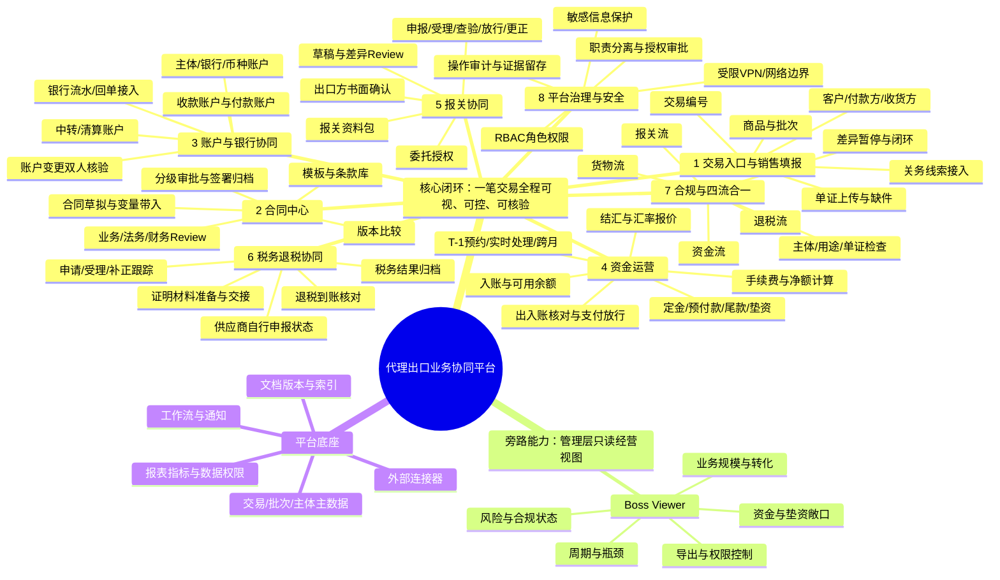

# 代理出口业务协同平台｜资方展示产品功能原型设计

> **文档状态：设计稿，供评审与原型深化。**  
> 本文描述目标产品体验，不代表现有页面已经具备相应生产能力。页面中的账号、交易金额、银行与监管状态应使用合成数据；银行、海关、税务等外部连接须以实际授权、接口条件及主管机构要求为准。

## 1. 产品定位与设计原则

### 1.1 产品定位

围绕代理出口业务建立一个以**交易编号**为核心的协同工作台，将销售订单、合同审签、货物与物流、报关、收付结汇、退税及合规证据连成可追踪的业务链。产品重点不是替代银行或监管机关作出结论，而是把多方协作、证据审核、资金核对、异常处置及责任留痕放在同一笔业务中管理。

### 1.2 资方演示要传达的价值

- **业务可视化：** 一笔业务从线索到结案的阶段、责任人、卡点一目了然。
- **资金可解释：** 每笔入账、结汇、费用、定金、尾款、中转及垫资有来源、有去向、有余额。
- **风险可阻断：** 资料不齐、版本变更、账户异常或四流差异会阻止后续关键动作。
- **协作可追责：** 业务、法务、财务、报关、税务等角色在各自权限内完成操作与复核。
- **规模可经营：** 管理者可从组合视角查看业务量、处理效率、资金占用和风险敞口。

### 1.3 设计原则

1. 一个交易编号贯穿全程，批次、合同、单证、银行流水及申报回执保留各自编号并建立关联。
2. **业务状态与证据状态分离：** “已提交”不等于“已审核”，“已汇款”不等于“银行已入账”，“已申报”不等于“已放行”。
3. 关键数据按版本留痕；影响审批、收付或申报的变更触发重新审核。
4. 自动化负责提示、匹配、计算和派单；高风险决策及外部执行保留授权人员复核。
5. 生产接入与离线演示明确区分，不用模拟状态暗示真实银行、海关或税务连接。

## 2. 自顶向下产品脑图

## 3. 产品信息架构与演示页面

| 页面 | 主要用户 | 资方演示时展示的重点 |
|---|---|---|
| 经营总览 / Boss Viewer | 管理层、资方观察者 | 业务规模、资金状态、在途时长、风险待办；只读且聚合展示 |
| 业务工作台 | 销售、运营 | 待办、交易阶段、缺件、异常和负责人 |
| 建立交易档案（01） | 运营、A—F资料责任方、人工审核员 | PC网页 / Mobile二维码邀请、VPN与身份门禁、分角色步骤1填报、运营汇总及人工终审 |
| 交易详情 / 四流时间线 | 运营、各流责任人 | 单笔业务全流程、证据、交接、时间线与阻断原因 |
| 合同中心 | 业务、法务、财务、审批人 | 模板、变量、Review意见、版本差异、审批轨迹及签署状态 |
| 资金中心 | 财务、资金经办 | 银行账户、流水匹配、结汇、费用、定金尾款和净额 |
| 报关协同 | 报关经办、出口方、运营 | 草稿版本确认、申报状态、回执、查验和更正 |
| 退税协同 | 税务经办、出口方 | 材料交接、申请受理、补正、结果及到账跟踪 |
| 合规与差异中心 | 合规、财务、运营 | 主体检查、四流匹配、异常队列、暂停范围和关闭条件 |
| 系统管理 | 管理员、安全管理员 | 用户、角色、权限、VPN边界策略摘要、审计查询 |

## 4. 功能模块设计

### 4.1 01 建立交易档案入口（已按操作指引步骤1细化）

**业务操作两层导航：** 一级目录始终展示“01 建立交易档案”“关务系统”“02–07 内部运营工作台”三个入口，仅说明有哪些工作区，不授予业务权限。进入工作区后，左侧栏及移动端下拉只展示该工作区当前岗位有权访问的页面，提供“返回工作入口目录”。建档区显示资料填报/汇总，关务区显示信息录入/查询，内部运营区按岗位显示业务场景；无权工作区明确提示，切换岗位保留工作区并重新核验，不自动跳转其他工作区。

**核对依据：**《代理出口业务操作指引》§3步骤1及§4各方职责、现有流程节点 N01 与材料清单 Q01—Q09。步骤1输出是“已批准的交易建档清单及交易文件夹”；B人工审批通过后，系统生成唯一交易单并关联交易档案。步骤1不对接收款银行。运输信息由E提供、A转交F；如建档时暂缺，可登记待补，但不能豁免后续物流 / 报关核验。

**面向用户的入口：**

- **PC网页入口：** 授权用户经受限VPN及身份校验进入公司工作台，由运营新建档案或发送角色化填报邀请。
- **Mobile二维码入口：** 运营为指定交易 / 受邀角色发出限时邀请二维码；扫码后先完成VPN / 身份校验，再进入仅授权字段的移动页面。二维码需在正式部署后绑定受控域名及短时令牌；当前展示区是占位，不是可扫描访问码。
- **PC / Mobile：** 同一档案使用响应式表单；桌面版方便运营核对全量字段，移动版按责任方分段填报、上传本次资料及确认提交。
- 当前浏览器的“VPN校验”是页面状态演示，不检测真实网络。生产环境还需要身份平台、VPN策略、设备要求、访问日志和邀请撤销机制。

**资料责任与字段（按原指引角色划分）：**

| 资料责任方 | 建档字段 | 材料 / 规则 |
|---|---|---|
| A 中国供应商 | 法定名称、主体识别号、注册地址、联系人及联系方式；货物名称、规格 / 型号、数量、计量单位、货值、币种、原产地及产品资料；销售合同 / 订单、商业发票、装箱单编号；页面可扩展单价、总金额、箱数 / 托盘数、净重 / 毛重 | 本次出口的合同 / 订单、商业发票、装箱单及原产地 / 产品资料；后续最终版在备货步骤更新核对。 |
| B 贸易代理商 | 法定名称及识别号、联系人；本笔代理业务指示、代理范围、收款路径、出款路径、预期币种及付款分支 | 记录D→B收款、B→A结算等本笔资金路径描述；不等于银行账户核验或付款授权。 |
| C 实际收货人 | 法定名称、国家 / 地区、注册号 / 主体识别信息、完整送货地址、收货联系人 / 电话、送货及收货安排 | C必须是本笔真实收货人；收货地址及支持资料关联本交易。 |
| D 付款方 | 法定名称、国家 / 地区、主体识别信息、联系人 / 电话；D向B付款确认、付款编号 / 金额 / 币种（可关联后续文件） | C与D不一致时，记录商业关系、付款原因和支持资料；无法解释时进入ON HOLD。 |
| E 物流公司 | 口岸、运输方式、运输工具 / 车辆、路线及预计提货 / 出运时间 | 步骤1可标“暂缺”并安排补齐；物流及报关前必须完成；E负责物流，不负责本流程出口报关。 |
| F 出口报关代理 | 服务商法定名称、资质编号 / 资质信息、联系人 / 电话 / 邮箱、服务范围、报价 / 计价方式及币种 | 资质、报价、联系人和服务范围是委任 / 签约审查输入；不能以流程图、历史样例替代。 |
| 运营 / 系统 | 交易角色映射、重复档案提示、资料来源 / 版本 / 责任人、待补项、人工核查记录、终审结论 | B运营汇总，核实A—F法定名称及角色；审核通过后生成唯一交易编号、交易单、交易目录及原件索引。 |

**原型页面与操作流程：**

展示结构收敛为一个入口说明栏（标题与“谁做什么”），下方一行网页 / 二维码使用方式，再直接展示可交互表单预览。PC与移动端切换位于预览上方；不再重复展示责任链、业务触发、步骤编号、关键输入 / 控制 / 输出等说明块。建档主页移除关务字段映射卡片，关务能力在目录“建立交易档案 → 关务系统”中独立展示。

1. 选入口：PC网页 / Mobile二维码；展示受限VPN状态及邀请入口。未通过访问门禁不能提交业务操作。
2. 分角色填报：A、B、C、D、E、F六组字段分别维护；可从角色邀请链接进入对应授权范围。
3. 材料归档：每个文件注明交易号、责任方、文件类型、来源、版本、上传时间及适用批次；网页端支持从本地选取多份附件、预览 / 移除，并可快捷选择材料目录中的模板和历史样例。模板 / 历史样例明确标记为参考，不计作本次出口原件。
4. 运营汇总：查看A—F主体与角色映射、C/D关系、交易资料和已关联材料明细；区分本地所选原件与目录参考文件，显示缺件和差异，不做自动合规批准。
5. 人工终审：B指定人工审核员检查资料与规则结果；退回时指出责任方、字段 / 材料及原因。
6. 建档通过：审核通过后系统才生成唯一交易单并关联档案、原件存储索引、数据库关键字段及审核记录；写入或关联失败不得返回成功。

**必须展示的状态：** `未开始` → `填报中` → `待补资料` / `待运营汇总` → `待人工终审` → `退回补充` / `ON HOLD` → `已批准并生成交易档案`。运输暂缺作为单独待补状态跟踪，不等于整体档案自动批准。

**历史档案快速填空：** A供应商页提供合成历史档案选择，将主体和商品常用字段填入当前草稿；不复制历史附件，也不自动沿用原交易的合同 / 发票 / 箱单编号。填充值逐字段显示来源，人工修改后来源更新为“人工修改”；须逐项确认，且已审批档案变更后要重新终审。

**关务系统子目录：**

- **信息录入：** 官方平台对接区与人工货品录入区分开。目标经企业授权取得可访问的报关单表头、商品明细、申报要素、法定单位、监管信息及回执；“报关信息大全”指授权业务范围内的完整信息，不表示公开获取所有企业数据。具体字段、接口、更新频率、证书及授权条件仍需与官方平台确认。原型显示“未配置授权”，禁用真实同步，不用合成条目冒充官方结果。
- **人工货品字段：** 名称、规格 / 型号 / 材质 / 用途、品牌、供应商 / 客户料号、商品编码、申报要素、成交单位 / 数量、第一及第二法定单位 / 数量、原产国、目的国、单价、总价、币制、箱数 / 包装件数与类型、净重、毛重、监管 / 检验检疫要求、来源依据及版本。名称、规格、成交单位 / 数量、原产国、币制、来源依据为必填；数量与金额须合法，法定单位不得凭成交单位自动推定。
- **信息查询：** A供应商与内部审核人员可查询授权条目的名称、编码、单位及全部明细；演示身份仅切换可见操作，不构成真实RBAC。内部核对要求商品编码及第一法定单位已补充；修改条目会撤销内部核对状态。内部核对不等于海关审核通过。
- **商品带入：** 原出口字段清单预览与15项合成映射移入该子目录。合成记录可载入关务台账后查询；人工录入 / 修改的记录也可明确点击带入建档商品字段，保留条目编号与来源，并使旧建档审批失效。申报要素、法定单位等关务字段留在关务条目中，不丢弃在建档简表中。
- **官方参考入口：** [中国国际贸易单一窗口](https://www.singlewindow.cn/)、[海关政务服务平台](https://online.customs.gov.cn/)。公开税则 / 单位参考与企业申报数据分别管理；归类及法定单位仍需对照适用版本和原始单证人工核实。

**本次原型实现范围：** 单入口说明栏、网页 / QR使用方式、PC / 移动端预览切换、VPN授权演示、A—F分角色字段、本地材料选择 / 预览 / 移除、合成历史填空、独立关务录入 / 修改 / 查询 / 核对 / 商品带入以及建档终审状态链。附件和关务条目只保存在当前页面内存，刷新后丢失；**不解析实际单证商品内容、不做OCR或HS归类，不连接官方接口或提交申报**。真实VPN、身份认证、可扫描二维码、服务端存储均不在离线原型中。

**字段调研依据：** 本地 [Export Docs 出口单证字段清单](../材料/_Export%20doc%20info%20list%20and%20explaination.xlsx)列出发票商品明细（描述、数量、单位、单价、金额、原产国）、装箱单商品明细（料号、数量、托盘、净重 / 毛重、箱数）、合同商品明细及报关单商品编号、名称规格、数量单位、价格总值币制等。官方依据：[海关办事指南（进出口货物申报）](https://online.customs.gov.cn/static/pages/guides/000629002001/000629002001.html)。

### 4.2 合同起草、模板管理、Review 与审批

**目标：** 由受控模板生成交易合同，集中处理条款风险、版本变更、审批与最终签署归档。

**模板管理：**

- 模板类型、语言、适用主体、币种 / 国家、适用业务分支、生效 / 失效日期。
- 模板编辑、业务审核、法务发布分权；保留版本号、变更说明和历史版本。
- 条款组件：付款期限、汇率及费用、交付责任、代理范围、违约、争议、数据及合规条款。
- 变量由交易主数据带入；缺值显式标红，不自动填充旧合同数据。

**合同工作区：**

- 合同编辑预览、字段来源、双方主体信息、条款检查清单。
- 版本差异视图：新增 / 删除 / 修改条款高亮。
- Review 评论定位到条款、字段和版本；支持`通过`、`退回修改`、`需补充材料`及`不适用说明`。
- 审批路线按合同类型、金额、币种、预付款 / 垫资和风险级别配置。
- 电子签署状态与签署件归档作为后续连接能力展示；资方演示中用模拟签署状态，不伪造签名。

**关键门禁：**

- 经办、Review、最终审批按角色分离；审批人不能审批自己提交的申请。
- 最终签署版本与审批版本绑定；签署后关键字段变化必须新建版本并重新审批。
- 账户、汇率、费用和付款期限与本笔结算方案互相校验。

### 4.3 账户管理与银行对接

**目标：** 清晰表达各主体、各币种的收款、付款和资金中转路径，并把银行真实回执与业务单据匹配。

**账户主数据设计：**

- 账户维度：法人主体 + 银行 + 币种 + 用途 + 生效期间。
- 每个适用的“主体 / 银行 / 币种”范围内配置有效收款账户与有效付款账户；具体是否严格限制为各一个，作为业务规则待确认。
- 中转 / 清算账户独立建档，注明账户持有人、银行、币种、允许用途及资金归属规则。
- 账户信息变更走申请、独立核验、复核、生效与历史版本；旧账户不物理覆盖。
- 界面只显示必要账号标识 / 掩码；完整账户详情按最小权限访问。

**银行接入与演示：**

- 银行连接器状态：未配置、待授权、连接正常、同步延迟、连接失败、人工导入。
- 数据类型：账户余额 / 可用余额、入账流水、结汇成交、手续费、出账指令状态、银行回单。
- 对接形态可展示为授权API / 银行主机连接 / 受控回单导入，实际方案需按银行能力和合同授权确定。
- 银行回调或文件导入后先进入“待匹配”；系统使用金额、币种、价值日、付款方、附言和唯一流水号建议匹配，不直接默认为已核销。
- 重复流水、重复回调、撤销 / 退款、迟到数据要有幂等处理及人工差异队列。

### 4.4 资金流、贸易核验入账、结算与对账

**目标：** 把“付款方汇款、来款登记、银行贸易核验入账及可用确认、费用、应付、出款、收款确认”拆成可核对的事件与余额。CNH与境内CNY均指人民币，余额释放不默认属于外币兑换；如确有兑换，另设业务、授权和凭证。CIPS承担支付清算，贸易真实性及合规核验由收款银行按适用要求办理。

**步骤5独立设计入口：**

“资金流设计 · V1”为独立入口，保留版本栏、账户资金图与一张标题为“信息流”的表格。删除账户价值、文件索引、撤销/冻结及后续卡片、示例和图示按钮；不再显示信息流标题下的追溯主链说明或表格后的运营原型说明。本次仅更新该独立设计页，其他业务工作台及可编辑流程图未同步为新的收费执行系统。

首屏展示：D原付款账户 → CIPS支付清算 → B的CNH不可用余额 → 收款银行核验入账并确认国内RMB可用余额 → 从该可用余额扣取两项费用至B收益账户 / 按批准结算额向A付款。计费触发与实际划转分开，不允许CNH不可用余额直转收益。V1不垫资；V2支持获批授信/自有资金先行垫付A，D后续回款核验入账后按协议核销垫资并清偿，不使用CNH不可用余额作垫资来源；版本栏为方案说明，未接入真实执行。

1. D将多笔货款合并为一笔CIPS汇款至B的银行账号，水单附言逐笔列明交易建档ID及金额。实际入账全额先记CNH不可用余额。
2. 全额记入CNH不可用余额后，按每笔实收本金×0.03%计提入账费一次；仅预留，不实际转收益。对应资金经银行核验入账为国内RMB可用后，才从该可用余额过扣至B收益账户；重复回执或重新匹配不重收。
3. 每贸易交易单完成INVOICE申报后计提人民币300元一次，补件、改版及重复申报不重收；计提不等待核验入账，但实际扣划必须等待对应资金进入国内RMB可用余额，再由该余额转B收益账户。
4. 收款银行核验真实贸易背景、付款关系和累计可收额度。仅核验通过且银行实际入账、可用状态均确认后，才幂等释放对应受限本金；内部批准、材料受理和CIPS清算成功均不能替代。补件或版本变化须重新审批。
5. 未匹配、超合同或待核验差额独立受限挂账，保留原汇款编号、D原付款路径、调查责任人及账龄。内部“不可用”只是产品使用门禁，不等于银行冻结、法定托管或法律隔离，不能据此长期接收无贸易背景资金。
6. 本V1场景不提供退款操作；需退汇时另经银行及合规确认正式程序，不预设36个月合规宽限、自动退款或到期转收益。

信息表逐行关联来款、入账费、分配、INVOICE申报、300元申报费、银行贸易核验、B收益及A付款。每项费用保存费用类型、计费键、来源来款、扣取与收益入账双边流水；金额及状态以实际凭证核实，不以内部计提冒充银行划转成功。

**资金事件台账：**

**B收益：两项均向D收取，从D本次来款直接扣除。** 入账费以`receipt_id + receipt_fee`为唯一计费键，基数为每笔银行实际入账本金，费率0.03%；INVOICE申报手续费以`trade_id + invoice_fee`为唯一计费键，每贸易交易单人民币300元。合并汇款只收一次该笔入账费，多笔贸易单分别收取申报费；同一贸易单不同INVOICE版本不构成新收费依据。

费用须取得D授权及银行确认的适用核验/扣划依据，费用与货款分项核验，不虚增货物贸易额。费用也须先从CNH入账为国内RMB可用余额，再实际扣划至收益账户；未确认可用、余额不足、冻结或路径未知时仅计提预留/待执行，不确认收益到账。双边回单核清后才确认划转，财税凭证及收入确认另行处理。

余额口径：实收本金＝已实际扣划费用＋待扣费用预留＋剩余货款（含未匹配/已付A）。费用预留在CNH或国内RMB状态下均不得重复用于货款分配/支付。两项均向D收取，不减少A合同应收；V1货款不足须D补足，不垫资。V2另走获批B垫资、后续回款清偿链路，须独立授信、锁额、审批及清偿台账。已扣费用不得再次扣减。

1. `付款方汇出`：金额、币种、付款方、付款编号、付款凭证、银行参考号。
2. `银行入账`：入账本金先记不可用，记录价值日、冻结 / 退款状态、流水号、入账账户、已关联明细及未匹配差额。
3. `中转清算`：转出 / 转入流水、来源交易、在途金额、清算时间及差额。
4. `贸易核验入账`：申请及核验编号、合同累计额度、核验本金、银行实际入账金额、可用状态、费用、时间及凭证；如为跨账户划转另存双边流水，不虚构银行扣账。
5. `费用与扣款`：银行费、中转费、服务费及其他扣费分项，分别挂接来源凭证及承担方。
6. `供应商结算`：应付总额、已付定金 / 预付款、待付尾款、扣费、拟付款净额、审批及付款回执。
7. `退款 / 冲正 / 退汇`：使用反向事件冲销关联流水，不删除原记录。

**结算场景：**

- 实时入账：银行确认实收后更新不可用余额；仅对应额度贸易核验入账且银行确认可用后释放。接口延迟显示“待确认”，不以付款截图代替。
- T-1：展示待核验金额、预约日 / 价值日、审批状态和银行入账及可用确认；实际定义及银行截点须确认。
- 跨月：分别保存交易日、银行价值日、核验日、入账及可用确认日和会计期间；跨期更正采用冲正 / 调整，不覆盖历史。
- 金额口径：本场景不默认兑换汇率；银行费用及实际可用确认须留痕，确有其他币种兑换时另行保留报价、成交与授权凭证。
- 定金尾款：每笔付款关联合同节点与应付余额；已付定金在尾款计算中扣减，累计支付不超过获批应付。
- 垫资：独立展示额度、币种、资金来源、已占用、可用额度、回收计划和实际清偿；未配置授权或超限不产生付款放行。

**净额试算展示：**

`可结算净额 = 银行贸易核验入账且确认可用金额 − 尚未扣除的银行及中转费用 − 合同约定扣款 − 已付定金 / 预付款`

试算页面必须同时展示原币金额与折算金额、使用汇率、计算时间、未纳入项和复核状态。公式为设计示意，实际合同口径、费用归属和跨币种处理由财务 / 法务确认。

**对账工作区：**

- 入账匹配：银行流水 ↔ 付款编号 ↔ 交易 / 批次。
- 出账匹配：获批结算单 ↔ 付款指令 ↔ 银行出账回执 ↔ A收款确认。
- 费用核对：银行费 / 中转费 / 服务费 ↔ 约定标准 ↔ 结算单扣款。
- 余额勾稽：应收、实收、贸易核验入账及可用释放、已付定金、尾款、中转在途及垫资余额。
- 差异类型：金额 / 币种 / 价值日 / 主体 / 账户 / 重复 / 手续费 / 未识别流水 / 逾期。

### 4.5 报关协同

**目标：** 从审核后的销售单证生成报关资料包，在申报前确认最终版本并回收正式回执。

- 报关资料清单按交易和批次生成：合同、发票、箱单、商品信息、授权、运输及必要证书。
- 销售字段到报关字段的映射表展示来源字段、转换规则、待确认值和责任人。
- 草稿版本比较：主体、商品、数量、金额、币种、国别、口岸和运输字段逐项高亮。
- 出口方对最终报关草稿进行书面确认，确认绑定文件版本 / 摘要；任何关键变更自动失效并重提确认。
- 经授权报关人员在正式渠道执行申报；系统记录受理号、申报时间、查验 / 退单 / 放行 / 更正结果及附件。
- 申报和放行状态严格分开；只有正式回执归档才更新对应阶段。

### 4.6 税务局对接与退税协同

**目标：** 串联证明材料、正式申请状态、补正及供应商退税结果，明确各方责任。

- 退税材料工作区按交易 / 批次呈现销售合同、发票、箱单、报关及放行、结算和证明资料。
- 证明申请职责、申请主体、正式渠道和时限保留为可配置项；以主管税务机关确认结果为准。
- 退税阶段状态：`资料准备` → `待提交` → `已受理` → `补正中` / `审核中` → `已处理` / `未通过` → `到账核实`。
- 对外连接设计：如存在获批接口则通过授权连接器同步；否则使用经授权人员在正式税务渠道办理后回填状态和回执，不暗示系统能直接提交。
- 退税到账是银行事件，与税务批准 / 处理结果分开展示。
- 供应商自行申报与代理 / 报关方材料协助分工明确，保存交接与接收证据。

### 4.7 合规与四流合一

**目标：** 让四流可以互相印证，支持风险暂停、责任分派、补证、复核及结案。

| 流 | 关键证据 | 核对重点 |
|---|---|---|
| 货物流 | 合同、发票、箱单、批次、物流计划、提货 / 运输 / 签收 | 主体、商品、数量、重量、批次和签收差异 |
| 报关流 | 授权、草稿、出口方确认、申报受理、正式报关单、放行 / 更正 | 申报主体、商品、金额、数量、口岸及版本 |
| 资金流 | 付款凭证、银行实际入账、可用余额、结汇、费用、出款及收款确认 | 付款方、币种、金额、价值日、手续费、定金尾款与余额 |
| 退税流 | 证明材料 / 正式签发、交付、申请 / 补正 / 结果 / 到账 | 交易与批次一致、正式来源、责任交接及处理结果 |

**合规控制区：**

- 主体及授权：实际交易主体、受益所有人、委托链、收货人 / 付款人关系和有效期。
- 交易合理性：商品、金额、路线、物流、付款路径及合同条件的一致性。
- 风险筛查：制裁、AML、出口管制、最终用途等核查证据、规则来源、执行时间、结果和复核人；系统不得自行宣称法定合规。
- 规则引擎：硬阻断 / 人工复核 / 提示三种等级；命中后记录原因、影响节点、责任人与解除证据。
- 四流差异：按交易号、批次、主体、商品、数量、币种、金额、日期和凭证关联进行匹配；容差需由业务 / 财务确认。
- 结案条件：必需证据齐备、异常闭环、资金余额可解释、垫资已按规则处置、税务阶段如实归档；特殊结案需要额外授权理由。

### 4.8 网络安全：受限 VPN 访问

**目标：** 把管理与外部连接能力放在明确的网络信任边界内，而不是把VPN当作唯一安全措施。

- 演示页面展示“内网 / 受限VPN访问”架构视图：允许访问的人群、受保护的业务应用、授权的银行 / 监管连接器和审计边界。
- 生产设计需由组织网络 / 安全团队定义VPN、设备与用户身份校验、最小网络路由、会话期限、异常登录告警及离职撤权。
- 外部银行 / 政务连接器按正式授权走独立服务身份与受控网络策略；不因用户接入VPN就开放到所有内部服务。
- 管理后台和敏感数据下载可采用更严格的网络位置、身份强度及二次审批条件。
- 审计记录登录、访问拒绝、权限变更、敏感操作和导出；密钥凭证由受控密钥设施管理，不写入页面代码或演示文件。

### 4.9 RBAC 权限设计

**目标：** 按角色、交易范围、字段敏感级别和职责冲突控制“谁能看、谁能改、谁能审核、谁能执行”。

| 角色 | 主要可见 / 可操作范围 | 关键限制 |
|---|---|---|
| 销售 / 业务经办 | 建交易、编辑本方未锁定资料、提交合同与单证 | 不终审自身提交，不执行付款或正式申报 |
| 运营 | 跨环节看板、任务分派、交易状态跟踪、异常协调 | 不代替财务或报关角色做专业确认 |
| 法务 / 合同管理员 | 模板、合同条款 Review、合同风险意见 | 模板发布与模板修改分权；不能绕过授权终审 |
| 财务经办 | 账户、入账匹配、结汇试算、对账和付款申请 | 不审批本人提交的付款；账号按需掩码 |
| 财务审批 / 资金授权人 | 审批额度内结算 / 付款放行 | MFA / 双人授权可配置；执行与审批留痕 |
| 报关经办 | 报关资料、草稿、申报状态及回执 | 不能代替出口方确认最终草稿 |
| 税务经办 | 证明 / 退税材料交接、状态跟踪 | 不代替纳税主体作出其自行申报决定 |
| 合规人员 | 主体 / 风险结果、核查材料、Hold解除复核 | 只解锁经授权范围；不得删除原命中和审计轨迹 |
| 系统管理员 | 账号、角色、组织、系统配置；编辑合同模板 | 不具备业务付款或审批权限；模板变更保留版本与审计记录 |
| Boss Viewer | 脱敏经营指标和授权范围内的业务汇总 | 只读；不查看完整账号、个人敏感资料和不必要的合同原文 |
| Super Admin | 全部业务模块及系统管理权限 | 全权限；敏感操作完整留痕 |
| 内部审计合规 | 全部业务模块、权限配置及审计轨迹的查看权限 | 全量只读；不可新建、编辑、提交、审核、执行或导出 |

**权限矩阵应覆盖：** 菜单访问、交易范围（本组织 / 指定客户 / 指定交易）、字段级查看 / 编辑、附件下载、审批动作、付款 / 申报执行、导出、管理配置及审计查询。权限需支持临时授权、到期回收、定期复核与冲突检查。

### 4.10 旁路：Boss Viewer 报表

**定位：** 管理层与资方快速了解业务规模和资金风险的只读视图，不介入单笔审批。

**当前原型：仅资金面板，移除单据管理面板。**

- 四个核心指标：累计CNH入账、CNY账面余额、B收益银行累计入账、A待净付款。
- 两幅趋势图：CNH入账与成功结汇原币；CNY结汇到账与净付A，分币种展示。
- 两幅环形饼图：CNH待匹配／匹配待结汇／已结汇；CNY余额／净付A／B收益银行划转／银行费。各图分项互斥。
- B收益银行划转柱状图、A已付／门禁齐备待付／被阻断待付条形图。
- 按建档范围、组织、交易或脱敏客户筛选；点击指标和图例展开只读资金明细。明细及口径默认折叠。
- 趋势按合成事件日期归集期间发生额；指标和饼图为筛选交易集合截至快照日的余额或累计量，不混作同一口径。
- 无银行连接，不同步运营审批；收益划转是独立银行账户双边核验设计，不等于利润或会计收入确认。

**展示要求：** 示例数据显著标注“合成数据”；只读且默认汇总，导出权限单独控制，敏感客户 / 账号信息脱敏。

## 5. 端到端资方演示故事线

以合成交易 `EX-D-2026-00128` / 批次 `LOT-01` 演示：

1. **建立交易档案：** 运营通过PC网页或Mobile二维码邀请A—F分角色补齐步骤1资料；VPN / 身份校验通过后，运营核对主体、C/D关系和本笔材料，由人工审核员终审，通过后生成唯一交易号。
2. **形成合同：** 选择模板并带入订单数据，展示一处条款差异、Review意见和审批状态。
3. **核验账户：** 查看收款 / 付款 / 中转账户分离；展示银行连接状态与待匹配回单，不使用真实账号。
4. **看资金闭环：** 展示一笔入账、汇率报价、手续费和定金，计算尾款；切换实时 / T-1 / 跨月处理口径。
5. **做报关确认：** 查看销售与报关字段差异，确认版本摘要，展示“正式申报待授权人员执行”及回执字段。
6. **跟进退税：** 查看材料交接、申请 / 补正 / 处理 / 到账分离状态及责任人。
7. **解释差异：** 展示手续费未匹配或某批次数量差异，系统进入Hold、指派责任人并阻止结案。
8. **回到管理层：** Boss Viewer显示该笔对组合资金、周期及风险指标的影响，并可按权限只读下钻。

## 6. 原型所需状态与演示交互

**通用状态：** 草稿、待补资料、待Review、审批中、已通过、已退回、处理中、待外部回执、已完成、异常暂停、已取消 / 已冲正。

**页面需演示的关键交互：**

- 点交易号进入交易时间线；点击节点查看责任人、证据、版本、时间及下一动作。
- 修改关键字段后展示“原审批失效 / 需重新确认”的提示。
- 收到银行流水后展示候选匹配、人工确认、拆分匹配及无法匹配的异常状态。
- 编辑金额、汇率和费用后实时试算净额，并显示使用口径；不产生支付指令。
- 对账发现差异后展示责任队列、处理期限、补证入口和复核关闭动作。
- 用角色切换演示不同RBAC菜单及脱敏效果；资方角色保持只读。

## 7. 原型优先级建议

### P0：资方演示必须可讲通

- 销售建档和唯一交易号。
- 合同模板、Review及审批轨迹。
- 账户分层、资金中转示意及银行连接状态。
- 入账、结汇、费用、定金尾款和T-1 / 跨月净额试算。
- 报关草稿确认、正式申报状态与回执字段。
- 税务退税状态跟踪。
- 四流对账、差异Hold及结案门禁。
- RBAC角色切换、受限VPN安全边界图。
- Boss Viewer只读仪表盘。

### P1：后续原型深化

- 模板配置台与条款组件管理。
- 银行流水匹配和人工拆分交互。
- 税务 / 报关补正任务的完整交互。
- 审计日志查询、权限申请 / 到期回收。
- 组合筛选、指标口径说明与脱敏导出。

### P2：生产方案另行论证

- 银行、海关、税务真实接口或授权代理接入。
- 电子签约、身份 / 名单核验及规则服务。
- 会计凭证、资金清算和机构级数据仓库接口。
- 高可用、灾备、密钥托管、运行监控和安全运营流程。

## 8. 需业务方确认的设计假设

1. “一个银行一个出账、一个入账”是否指每个主体 / 币种 / 业务用途仅有一个当前有效账户，还是银行级严格一进一出；是否存在多分支账户或备用账户。
2. T-1的业务定义、银行截点、价值日、周末 / 节假日与跨月会计规则。
3. 汇率来源、汇率有效期、结汇权限、点差及各类费用的合同承担方。
4. 定金、尾款、垫资额度、单笔 / 总额上限、审批人及清偿顺序。
5. 证明申请与退税协同的实际责任主体、税务渠道和可用接口；不可将流程图中的责任推定为正式规则。
6. 交易主体、客户数据和Boss Viewer的资方可见范围、脱敏方式与导出审批条件。
7. VPN接入由哪个网络 / 安全域提供，是否有设备准入、MFA、专用访问通道及审计要求。

## 9. 设计验收标准

- 资方可在10分钟演示中从一笔新交易走到四流差异与管理层看板。
- 任何业务金额均能回溯到币种、来源流水 / 单据、汇率、费用、审批和计算口径。
- 能明确区分付款方已汇出、银行已入账、资金可用、已结汇、已批准付款和A已收款。
- 合同 / 报关 / 资金关键数据变化会显示受影响审批和需要重做的节点。
- 四流差异有类型、金额 / 数量、证据、责任人、处理状态和关闭复核。
- 不同角色的页面和敏感字段可见性有明显差异；Boss Viewer不能执行交易操作。
- 演示页面能清楚区分合成数据、待接入能力与真实生产执行。
