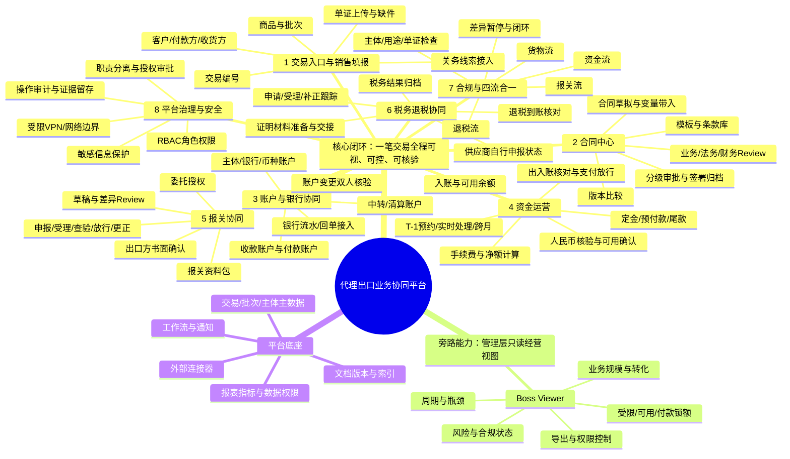

# 代理出口业务协同平台｜资方展示产品功能原型设计

> **文档状态：设计稿，供评审与原型深化。**  
> 本文描述目标产品体验，不代表现有页面已经具备相应生产能力。页面中的账号、交易金额、银行与监管状态应使用合成数据；银行、海关、税务等外部连接须以实际授权、接口条件及主管机构要求为准。

## 1. 产品定位与设计原则

### 1.1 产品定位

围绕代理出口业务建立以**交易编号**为核心的协同工作台，将订单、合同审签、物流、报关、人民币收付、退税及合规证据连成可追踪业务链。系统不替代银行或监管结论，重点是多方协作、证据审核、资金核对、异常处置及责任留痕。

### 1.2 资方演示要传达的价值

- **业务可视化：** 一笔业务从线索到结案的阶段、责任人、卡点一目了然。
- **资金可解释：** 每笔实收、核验/释放、费用、定金、尾款及锁额有来源、有去向、有余额，不含换汇/垫资。
- **风险可阻断：** 资料不齐、版本变更、账户异常或四流差异会阻止后续关键动作。
- **协作可追责：** 业务、法务、财务、报关、税务等角色在各自权限内完成操作与复核。
- **规模可经营：** 管理者可从组合视角查看业务量、处理效率、资金占用和风险敞口。

### 1.3 设计原则

1. 一个交易编号贯穿全程，批次、合同、单证、银行流水及申报回执保留各自编号并建立关联。
2. **业务状态与证据状态分离：** “已提交”不等于“已审核”，“已汇款”不等于“银行已入账”，“已申报”不等于“已放行”。
3. 关键数据按版本留痕；影响审批、收付或申报的变更触发重新审核。
4. 自动化负责提示、匹配、计算和派单；高风险决策及外部执行保留授权人员复核。
5. 生产接入与离线演示明确区分，不用模拟状态暗示真实银行、海关或税务连接。

## 2. 自顶向下产品脑图

## 3. 产品信息架构与演示页面

| 页面 | 主要用户 | 资方演示时展示的重点 |
|---|---|---|
| 经营总览 / Boss Viewer | 管理层、资方观察者 | 业务规模、资金状态、在途时长、风险待办；只读且聚合展示 |
| 业务工作台 | 销售、运营 | 待办、交易阶段、缺件、异常和负责人 |
| 建立交易档案（01） | A供应商、D付款方；B只读 | A首次提交创建交易；A/D分别维护本方资料；签约依据送审与独审在步骤二 |
| 交易详情 / 四流时间线 | 运营、各流责任人 | 单笔业务全流程、证据、交接、时间线与阻断原因 |
| 合同中心 | 业务、法务、财务、审批人 | 模板、变量、Review意见、版本差异、审批轨迹及签署状态 |
| 资金中心 | 财务、资金经办 | 不可变银行配置、实收匹配、核验/可用、费用、定金尾款及锁额 |
| 报关协同 | 报关经办、出口方、运营 | 草稿版本确认、申报状态、回执、查验和更正 |
| 退税协同 | 税务经办、出口方 | 材料交接、申请受理、补正、结果及到账跟踪 |
| 合规与差异中心 | 合规、财务、运营 | 主体检查、四流匹配、异常队列、暂停范围和关闭条件 |
| 系统管理 | 管理员、安全管理员 | 用户、角色、权限、VPN边界策略摘要、审计查询 |

## 4. 功能模块设计

**本轮领域设计口径：** 仅人民币CNY，不支持换汇、授信、垫资、透支；合同默认每trade、每必需用途一签，公共协议只按明确主体/用途/有效期间及确切签署版引用。D货款资金位置仅受限、可用、付款锁额；固定人民币300元代理服务费由D承担，在首次获批分账时从D已核验可用余额一次性结算；INVOICE申报不触发收费，不按本金比例抽佣且不减少A合同应付。现行实体、码表及状态机已合并至[主方案数据库设计](代理出口业务流程图.html#database-design/trade)及[状态机设计](代理出口业务流程图.html#state-design/trade)，JSON与边界见[领域说明](../doc/领域拆分评估与交易域设计.md)。两设计页共用唯一领域模型，旧领域HTML仅保留入口；主业务流程及其他原型行为未随模型替换，差异在设计页单独说明，不能把逻辑设计当作后端或真实银行能力已实现。

### 4.1 01 建立交易档案与内外协同工作台

主导航“内外协同工作台”提供A/D和B/E/F全流程任务；业务操作的“01 建立交易档案”链接至同一工作台。旧邀请填报和终审建单表单不再作为建档入口。关务系统和其他专题仍可独立访问，其历史演示数据不自动合并到协同记录。

步骤一以最新四个系统用例为准：A首次提交、D首次提交、A修改原资料、D修改原付款资料。A预取号不创建交易，A首次提交才创建同号交易；D仅创建本方一份资料。B在步骤一只读。C没有独立入口，A收集C及适用B/E/F资料，D独立声明付款关系；签约依据汇总送审及独立审核属于步骤二。

| 资料责任 | 可操作字段及材料 | 边界 |
|---|---|---|
| A供应商 | 主体身份、地址、联系方式引用；C及送货安排；拟付款主体；商品规格、原产地、数量、单位、单价、人民币金额；合同、发票、箱单号；箱数、净毛重；材料确切版本；适用B/E/F资料及服务范围、付款路径 | 修改预填原本方资料，增加差异说明，提交后修订原资源；D已声明关系时不能直接替换收货或拟付款主体 |
| D付款方 | 主体身份、国家地区、联系人引用；与C的法定主体关系类型、商业关系和付款原因；不同主体的支持材料 | 同一法定主体可不填关系证明，不允许以同名推定同主体；不能修改A资料或银行实收 |
| B运营 | 只读核对A/D已提交资料；步骤二汇总当前签约依据 | 不替A/D填报、不提前终审建单；独审人不能审核本人经办或提交的版本 |
| E物流、F报关代理 | 共用内部任务目录；分别提交受托批次运输证据、报关草稿等后续资料 | 不新增步骤一首次填报；共用目录不授予他方数据和资金办理权 |

操作顺序：

1. A进入首次提交任务，预取合成号，填入并保存本方资料，核对保存版本后确认提交。
2. D在交易及关系已核实的前提下独立填报、保存和提交；本机演示身份不构成真实关系核实。
3. A/D分别从修改入口修订原资料，保留对方声明及原受理历史。
4. B在步骤二送审签约依据，另一位演示人员以独立审核员身份逐版审核或退回。上游改版使相关结论失效。
5. 出现响应丢失时用原提交人恢复原受理，不重新取号；普通待审申请可撤回补正，首次提交不能撤回删除交易。

协同工作台只保存合成文本和材料引用，不读取真实单证。单商品行演练校验数量、单价与金额一致，数量最多六位小数、金额最多两位；仅CNY，箱数为非负整数，毛重不小于净重。多商品行、附件上传与正式外部执行未实现。演示记录保存在独立localStorage键`export-product-workspace/v1`，刷新保留，不能跨设备使用。

对外操作见[对外产品需求与操作手册](../doc/对外产品需求与操作手册.html)，对内操作见[对内运营产品需求与操作手册](../doc/对内运营产品需求与操作手册.html)。两册涵盖八阶段69用例、N01至N23，说明字段、办理条件、状态和异常恢复。正式银行、电子签、海关、税务结果没有接入，资料审核不生成外部成功事实。

**关务系统子目录：**

- **信息录入：** 官方平台对接区与人工货品录入区分开。目标经企业授权取得可访问的报关单表头、商品明细、申报要素、法定单位、监管信息及回执；“报关信息大全”指授权业务范围内的完整信息，不表示公开获取所有企业数据。具体字段、接口、更新频率、证书及授权条件仍需与官方平台确认。原型显示“未配置授权”，禁用真实同步，不用合成条目冒充官方结果。
- **人工货品字段：** 名称、规格 / 型号 / 材质 / 用途、品牌、供应商 / 客户料号、商品编码、申报要素、成交单位 / 数量、第一及第二法定单位 / 数量、原产国、目的国、单价、总价、币制、箱数 / 包装件数与类型、净重、毛重、监管 / 检验检疫要求、来源依据及版本。名称、规格、成交单位 / 数量、原产国、币制、来源依据为必填；数量与金额须合法，法定单位不得凭成交单位自动推定。
- **信息查询：** A供应商与内部审核人员可查询授权条目的名称、编码、单位及全部明细；演示身份仅切换可见操作，不构成真实RBAC。内部核对要求商品编码及第一法定单位已补充；修改条目会撤销内部核对状态。内部核对不等于海关审核通过。
- **商品带入：** 原出口字段清单预览与15项合成映射移入该子目录。合成记录可载入关务台账后查询；人工录入 / 修改的记录也可明确点击带入建档商品字段，保留条目编号与来源，并使旧建档审批失效。申报要素、法定单位等关务字段留在关务条目中，不丢弃在建档简表中。
- **官方参考入口：** [中国国际贸易单一窗口](https://www.singlewindow.cn/)、[海关政务服务平台](https://online.customs.gov.cn/)。公开税则 / 单位参考与企业申报数据分别管理；归类及法定单位仍需对照适用版本和原始单证人工核实。

关务条目仍是独立专题，录入、查询和核对记录只保存在页面内存，刷新丢失，不自动带入新协同存档。原专题中的历史建档商品带入说明仅适用于旧演示。正式VPN、身份认证、二维码邀请、附件上传和服务端存储均未接入。

**字段调研依据：** 本地 [Export Docs 出口单证字段清单](../材料/_Export%20doc%20info%20list%20and%20explaination.xlsx)列出发票商品明细（描述、数量、单位、单价、金额、原产国）、装箱单商品明细（料号、数量、托盘、净重 / 毛重、箱数）、合同商品明细及报关单商品编号、名称规格、数量单位、价格总值币制等。官方依据：[海关办事指南（进出口货物申报）](https://online.customs.gov.cn/static/pages/guides/000629002001/000629002001.html)。

### 4.2 合同起草、模板管理、Review 与审批

**目标：** 由受控模板生成交易合同，集中处理条款风险、版本变更、审批与最终签署归档。

默认每trade、每协议用途一签，覆盖A–B代理、A–E物流、A–F报关及有效委托；同trade同用途补充/更正走原合同新版本。公共协议是显式例外，必须冻结法定主体、允许用途、有效起止和签署版，逐单核对并引用，不自动续期/豁免必签协议。主合同只存身份和当前工作版，审核/签署/有效期均归合同版本。

**模板管理：**

- 模板用途、语言、适用主体、CNY / 国家、预付/出口后分支、生效 / 失效日期。
- 模板编辑、业务审核、法务发布分权；保留版本号、变更说明和历史版本。
- 条款组件：人民币付款期限及费用、交付责任、代理范围、违约、争议、数据及合规条款；历史汇率文字保留原件供差异审阅，不启用换汇。
- 变量由交易主数据带入；缺值显式标红，不自动填充旧合同数据。

**合同工作区：**

- 合同编辑预览、字段来源、双方主体信息、条款检查清单。
- 版本差异视图：新增 / 删除 / 修改条款高亮。
- Review 评论定位到条款、字段和版本；支持`通过`、`退回修改`、`需补充材料`及`不适用说明`。
- 审批路线按协议用途、金额、预付款/出口后分支和风险级别配置，不包含垫资。
- 电子签署状态与签署件归档作为后续连接能力展示；资方演示中用模拟签署状态，不伪造签名。

**关键门禁：**

- 经办、Review、最终审批按角色分离；审批人不能审批自己提交的申请。
- 合同版本唯一生命周期：编辑、待审核、待补、待签、已签、已生效、已替代、已终止；审核正文与签署件独立冻结，签后更正新版本，旧有效版仅因正式替代/终止决定失效。
- 文件最终确认仅代表可引用资格，不代表审核通过；旧文件被替代不自动改变合同法律状态。账户、CNY金额、费用和付款期限与本笔结算方案校验。

### 4.3 账户管理与银行对接

**目标：** 清晰表达各主体人民币收付路径，区分外部真实银行账号配置和内部三位置控制账户，把银行真实回执与业务单据匹配。

**账户主数据设计：**

- 账户维度：法人主体 + 银行 + 币种 + 用途 + 生效期间。
- 每个适用的“主体 / 银行 / 币种”范围内配置有效收款账户与有效付款账户；具体是否严格限制为各一个，作为业务规则待确认。
- 中转 / 清算账户独立建档，注明账户持有人、银行、币种、允许用途及资金归属规则。
- 核验后配置载荷冻结，变更新配置业务号/递增版并重新核验；稳定账号指纹跨版不变，银行事实按指纹+银行事件键去重。批准冻结配置，执行仍查启停/有效期，不自动换新账号。
- 界面只显示必要账号标识 / 掩码；完整账户详情按最小权限访问。

**银行接入与演示：**

- 银行连接器状态：未配置、待授权、连接正常、同步延迟、连接失败、人工导入。
- 数据类型：银行余额/可用确认、实收/实付流水、手续费、出账指令及银行回单；不含换汇成交。
- 对接形态可展示为授权API / 银行主机连接 / 受控回单导入，实际方案需按银行能力和合同授权确定。
- 银行回调或文件导入后先进入“待匹配”；系统使用金额、币种、价值日、付款方、附言和唯一流水号建议匹配，不直接默认为已核销。
- 重复流水、重复回调、撤销 / 退款、迟到数据要有幂等处理及人工差异队列。

### 4.4 资金流、贸易核验入账、结算与对账

**目标：** 分别保存汇出、银行实收、毛额分配、贸易核验、银行可用、费用、审批、扣款、到账、记账及对账事实。币种固定CNY，CNH仅为银行位置描述，不发生换汇。CIPS是支付清算，不替代收款银行贸易核验。三位置为受限、可用、付款锁额；未知银行结果保持执行中/锁额，查同一请求，不新指令重付。

**步骤5独立设计入口：**

“资金流设计 · V1”为独立入口，保留版本栏、账户资金图与一张标题为“信息流”的表格。删除账户价值、文件索引、撤销/冻结及后续卡片、示例和图示按钮；不再显示信息流标题下的追溯主链说明或表格后的运营原型说明。本次仅更新该独立设计页，其他业务工作台及可编辑流程图未同步为新的收费执行系统。

首屏设计：D付款→银行实收受限→核验及可用确认→可用→首次获批分账时从D可用余额结算300元服务费→按合同向A支付货款。固定服务费由D承担；INVOICE申报不触发收费，D授权及收费依据必须齐备，且不减少A合同应付。银行实际费用按凭证单列并按协议承担。

1. D将多笔货款合并为一笔CIPS汇款至B的银行账号，水单附言逐笔列明交易建档ID及金额。实际入账全额先记CNH不可用余额。
2. 收款银行核验真实贸易背景、付款关系和累计可收额度。仅核验通过且银行实际入账、可用状态均确认后，才幂等释放对应受限本金；内部批准、材料受理和CIPS清算成功均不能替代。补件或版本变化须重新审批。
3. 固定人民币300元服务费由D承担，在贸易核验通过且可用余额确认后，于该交易首次获批分账时按trade唯一键从D可用余额一次性结算。INVOICE申报、补件、改版及重复分账不触发或重复扣费；须有正式收费依据及D授权，且不得减少A合同应付。
4. 服务费不按实收本金或货值比例计算；仅在首次获批分账时从D已核验可用余额结算，不从D来款毛额计提，不减少A合同应付。服务费结算事件与银行货款入账、A货款付款分开记账；D授权或可用余额不足时不得结算或完成该次分账。
5. 银行 / 中转费用只按实际凭证分项列示，承担方以有效协议为准，不作为B的代理服务费，不通过比例收费或货款净额调整代收。
6. 未匹配、超合同或待核验差额独立受限挂账，保留原汇款编号、D原付款路径、调查责任人及账龄。内部“不可用”只是产品使用门禁，不等于银行冻结、法定托管或法律隔离，不能据此长期接收无贸易背景资金。
7. 不提供任意/自动退款；正式退款/退汇单须原始收付、银行程序、合规授权及可退上限，经锁额和实际回执闭环。它不是内部凭证冲正，不预设长期合规宽限或到期转收益。

信息表逐行关联D来款、货款分配、INVOICE申报、银行贸易核验、首次获批分账及A货款付款。服务费保存交易号、固定金额、收费依据、D授权、来源分配及event 12结算凭证；不得伪造成银行扣款，也不得减少A合同应付。

**资金事件台账：**

**收费口径：** 当前产品设计仅设置一项代理服务费：每笔固定人民币300元，由D承担，在首次获批分账时从D已核验可用余额一次性结算；不按实收本金比例计费，INVOICE申报不触发扣费。须有正式收费依据及D授权；事件按trade唯一键防止重复，不减少A合同应付。原合同模板中的冲突条款须正式修订。银行及中转费用凭实际凭证另列，按合同确定承担方。

货款与服务费分项核验，不虚增货值。D来款按贸易核验及分账规则处理；首次获批分账时，固定300元从D已核验可用余额转列服务费。该内部事件不是银行扣款，也不改变A合同应付。收入确认、税额及适用发票按正式财税政策处理。

毛额归属：实收本金=有效货款分配+未匹配毛额；A货款付款不改变原始毛额。三桶之和按真实资金位置重算；首次获批分账时事件12减少D可用余额300元，不伪造外部收支。A合同应付独立核算；银行实际费用按凭证记录，不得重复扣减。

1. `付款方汇出`：金额、币种、付款方、付款编号、付款凭证、银行参考号。
2. `银行入账`：入账本金先记不可用，记录价值日、冻结 / 退款状态、流水号、入账账户、已关联明细及未匹配差额。
3. `中转清算`：转出 / 转入流水、来源交易、在途金额、清算时间及差额。
4. `贸易核验入账`：申请及核验编号、合同累计额度、核验本金、银行实际入账金额、可用状态、费用、时间及凭证；如为跨账户划转另存双边流水，不虚构银行扣账。
5. `费用与扣款`：银行费、中转费、D服务费及其他扣费分项，分别挂接来源凭证、承担方及授权。
6. `供应商结算`：A合同应付总额、已付定金 / 预付款、待付金额、实际银行费用、D可用余额服务费结算、拟付款金额、审批及付款回执；服务费不得作为A应付扣项。
7. `退款 / 冲正 / 退汇`：正式银行反向程序与内部整凭证冲正分开；追加反向事件/分录，不删原记录、不回写分录冲正标记。

**结算场景：**

- 实时入账：银行确认实收后更新不可用余额；仅对应额度贸易核验入账且银行确认可用后释放。接口延迟显示“待确认”，不以付款截图代替。
- T-1：展示待核验金额、预约日 / 价值日、审批状态和银行入账及可用确认；实际定义及银行截点须确认。
- 跨月：分别保存交易日、银行价值日、核验日、入账及可用确认日和会计期间；跨期更正采用冲正 / 调整，不覆盖历史。
- 金额口径：固定CNY、落账两位小数；不提供兑换。保留适用银行书面条件及原始历史报价证据，不生成虚构汇率字段。
- 定金尾款：每笔付款关联合同节点与应付余额；已付定金在尾款计算中扣减，累计支付不超过获批应付。
- 垫资：不在本次范围，不展示可执行额度/清偿操作。

**净额试算展示：**

`本次可付上限 = min(A批准剩余应付, 来源可用余额)`

仅显示人民币、金额来源/版本、已付/锁额、计算时刻和复核状态；从D可用余额结算的300元服务费用于展示可付款资金上限，不减少A合同应付，已付定金已含在剩余应付中，不再减一次。银行实际费用凭证列示并按合同确定承担方。预付与出口后分别核对必要协议、同一F委任/授权、A草稿批准、B已收申报件及放行等门禁，详见领域说明§9.3。试算不产生付款指令。

**对账工作区：**

- 入账匹配：银行流水 ↔ 付款编号 ↔ 交易 / 批次。
- 出账匹配：获批结算单 ↔ 付款指令 ↔ 银行出账回执 ↔ A收款确认。
- 费用核对：银行费 / 中转费 / D服务费 ↔ 约定依据及授权 ↔ 结算单与event 12。
- 余额勾稽：毛额分配、核验/可用、三桶、D服务费结算、A合同应付/已付及剩余应付，分别重算分录并核对银行，不含垫资。
- 差异类型：金额 / 币种 / 价值日 / 主体 / 账户 / 重复 / 手续费 / 未识别流水 / 逾期。

### 4.5 报关协同

**目标：** 从审核后的销售单证生成报关资料包，在申报前确认最终版本并回收正式回执。

- 报关资料清单按交易和批次生成：合同、发票、箱单、商品信息、授权、运输及必要证书。
- 销售字段到报关字段的映射表展示来源字段、转换规则、待确认值和责任人。
- 草稿版本比较：主体、商品、数量、金额、币种、国别、口岸和运输字段逐项高亮。
- 出口方对最终报关草稿进行书面确认，确认绑定文件版本 / 摘要；任何关键变更自动失效并重提确认。
- 经授权报关人员在正式渠道执行申报；系统记录受理号、申报时间、查验 / 退单 / 放行 / 更正结果及附件。
- 申报和放行状态严格分开；只有正式回执归档才更新对应阶段。

### 4.6 税务局对接与退税协同

**目标：** 串联证明材料、正式申请状态、补正及供应商退税结果，明确各方责任。

- 退税材料工作区按交易 / 批次呈现销售合同、发票、箱单、报关及放行、结算和证明资料。
- 证明申请职责、申请主体、正式渠道和时限保留为可配置项；以主管税务机关确认结果为准。
- 退税阶段状态：`资料准备` → `待提交` → `已受理` → `补正中` / `审核中` → `已处理` / `未通过` → `到账核实`。
- 对外连接设计：如存在获批接口则通过授权连接器同步；否则使用经授权人员在正式税务渠道办理后回填状态和回执，不暗示系统能直接提交。
- 退税到账是银行事件，与税务批准 / 处理结果分开展示。
- 供应商自行申报与代理 / 报关方材料协助分工明确，保存交接与接收证据。

### 4.7 合规与四流合一

**目标：** 让四流可以互相印证，支持风险暂停、责任分派、补证、复核及结案。

| 流 | 关键证据 | 核对重点 |
|---|---|---|
| 货物流 | 合同、发票、箱单、批次、物流计划、提货 / 运输 / 签收 | 主体、商品、数量、重量、批次和签收差异 |
| 报关流 | 授权、草稿、出口方确认、申报受理、正式报关单、放行 / 更正 | 申报主体、商品、金额、数量、口岸及版本 |
| 资金流 | 汇出证据、银行实收、核验/可用、费用、锁额、扣款/到账及记账 | 付款方、CNY金额、价值日、费用归属、定金尾款及三桶余额 |
| 退税流 | 证明材料 / 正式签发、交付、申请 / 补正 / 结果 / 到账 | 交易与批次一致、正式来源、责任交接及处理结果 |

**合规控制区：**

- 主体及授权：实际交易主体、受益所有人、委托链、收货人 / 付款人关系和有效期。
- 交易合理性：商品、金额、路线、物流、付款路径及合同条件的一致性。
- 风险筛查：制裁、AML、出口管制、最终用途等核查证据、规则来源、执行时间、结果和复核人；系统不得自行宣称法定合规。
- 规则引擎：硬阻断 / 人工复核 / 提示三种等级；命中后记录原因、影响节点、责任人与解除证据。
- 四流差异：按交易号、批次、主体、商品、数量、币种、金额、日期和凭证关联进行匹配；容差需由业务 / 财务确认。
- 结案条件：必需签约/履约证据齐备、异常闭环、三桶/款项/凭证核清、税务阶段如实归档；特殊结案需额外授权，不以结束页面流程掩盖未清义务。

### 4.8 网络安全：受限 VPN 访问

**目标：** 把管理与外部连接能力放在明确的网络信任边界内，而不是把VPN当作唯一安全措施。

- 演示页面展示“内网 / 受限VPN访问”架构视图：允许访问的人群、受保护的业务应用、授权的银行 / 监管连接器和审计边界。
- 生产设计需由组织网络 / 安全团队定义VPN、设备与用户身份校验、最小网络路由、会话期限、异常登录告警及离职撤权。
- 外部银行 / 政务连接器按正式授权走独立服务身份与受控网络策略；不因用户接入VPN就开放到所有内部服务。
- 管理后台和敏感数据下载可采用更严格的网络位置、身份强度及二次审批条件。
- 审计记录登录、访问拒绝、权限变更、敏感操作和导出；密钥凭证由受控密钥设施管理，不写入页面代码或演示文件。

### 4.9 RBAC 权限设计

**目标：** 按角色、交易范围、字段敏感级别和职责冲突控制“谁能看、谁能改、谁能审核、谁能执行”。

| 角色 | 主要可见 / 可操作范围 | 关键限制 |
|---|---|---|
| 销售 / 业务经办 | 建交易、编辑本方未锁定资料、提交合同与单证 | 不终审自身提交，不执行付款或正式申报 |
| 运营 | 跨环节看板、任务分派、交易状态跟踪、异常协调 | 不代替财务或报关角色做专业确认 |
| 法务 / 合同管理员 | 模板、合同条款 Review、合同风险意见 | 模板发布与模板修改分权；不能绕过授权终审 |
| 财务经办 | 账户、实收匹配、人民币净额试算、对账和付款申请 | 不审批本人提交的付款；账号按需掩码 |
| 财务审批 / 资金授权人 | 审批额度内结算 / 付款放行 | MFA / 双人授权可配置；执行与审批留痕 |
| 报关经办 | 报关资料、草稿、申报状态及回执 | 不能代替出口方确认最终草稿 |
| 税务经办 | 证明 / 退税材料交接、状态跟踪 | 不代替纳税主体作出其自行申报决定 |
| 合规人员 | 主体 / 风险结果、核查材料、Hold解除复核 | 只解锁经授权范围；不得删除原命中和审计轨迹 |
| 系统管理员 | 账号、角色、组织、系统配置；编辑合同模板 | 不具备业务付款或审批权限；模板变更保留版本与审计记录 |
| Boss Viewer | 脱敏经营指标和授权范围内的业务汇总 | 只读；不查看完整账号、个人敏感资料和不必要的合同原文 |
| Super Admin | 全部业务模块及系统管理权限 | 全权限；敏感操作完整留痕 |
| 内部审计合规 | 全部业务模块、权限配置及审计轨迹的查看权限 | 全量只读；不可新建、编辑、提交、审核、执行或导出 |

**权限矩阵应覆盖：** 菜单访问、交易范围（本组织 / 指定客户 / 指定交易）、字段级查看 / 编辑、附件下载、审批动作、付款 / 申报执行、导出、管理配置及审计查询。权限需支持临时授权、到期回收、定期复核与冲突检查。

### 4.10 旁路：Boss Viewer 报表

**定位：** 管理层与资方快速了解业务规模和资金风险的只读视图，不介入单笔审批。

**目标设计：仅资金面板。旧原型CNH/CNY“结汇”图表为历史展示，待按本轮单币种口径实施，不代表真实换汇能力。**

- 核心指标：累计人民币实收、三桶存量、D服务费结算、A货款实付及A合同应付剩余；存量与累计分别注明，不相加。
- 趋势按实收、可用释放、首次获批分账服务费结算及向A实付分别展示，均为CNY。
- 存量分布仅受限/可用/付款锁额，互斥且同一时点；event 12服务费结算作为可用余额去向单列。
- A货款实付与D服务费结算分别展示，另列A已付／门禁齐备待付／被阻断待付货款。
- 按建档范围、组织、交易或脱敏客户筛选；点击指标和图例展开只读资金明细。明细及口径默认折叠。
- 趋势按合成事件日期归集期间发生额；指标和饼图为筛选交易集合截至快照日的余额或累计量，不混作同一口径。
- 无银行连接，不同步运营审批；D服务费内部结算不等于独立银行扣款或会计收入确认。

**展示要求：** 示例数据显著标注“合成数据”；只读且默认汇总，导出权限单独控制，敏感客户 / 账号信息脱敏。

## 5. 端到端资方演示故事线

以合成交易 `EX-D-2026-00128` / 批次 `LOT-01` 演示：

1. **建立交易档案：** 创建即分配交易号，运营通过PC或Mobile邀请A—F补资料，核对主体/C-D关系，由独立审核员终审，批准沿用同号。
2. **形成合同：** 选择模板并带入订单数据，展示一处条款差异、Review意见和审批状态。
3. **核验账户：** 查看收款 / 付款 / 中转账户分离；展示银行连接状态与待匹配回单，不使用真实账号。
4. **看资金闭环：** 展示人民币实收、毛额分配、核验/可用、货款锁额、D服务费结算与A合同应付剩余；服务费事件关联D可用余额，不伪造银行收支且不减少A应付。切换实时 / T-1 / 跨月口径，不展示虚构换汇。
5. **做报关确认：** 查看销售与报关字段差异，确认版本摘要，展示“正式申报待授权人员执行”及回执字段。
6. **跟进退税：** 查看材料交接、申请 / 补正 / 处理 / 到账分离状态及责任人。
7. **解释差异：** 展示手续费未匹配或某批次数量差异，系统进入Hold、指派责任人并阻止结案。
8. **回到管理层：** Boss Viewer显示该笔对组合资金、周期及风险指标的影响，并可按权限只读下钻。

## 6. 原型所需状态与演示交互

**状态不能跨实体复用：** 交易见§4.1；合同版本见§4.2；资金类型按各自状态机持久化完成/拒绝/取消/替代，银行未知仅执行投影；凭证仅记账中/已记账/已冲正/失败。账户启停、文件资格、对账差异和案件暂停各有独立状态，不把工作台的通用展示词当数据库枚举。

**页面需演示的关键交互：**

- 点交易号进入交易时间线；点击节点查看责任人、证据、版本、时间及下一动作。
- 修改关键字段后展示“原审批失效 / 需重新确认”的提示。
- 收到银行流水后展示候选匹配、人工确认、拆分匹配及无法匹配的异常状态。
- 编辑人民币金额及经授权费用后实时试算净额，显示来源/口径；不产生支付指令。
- 对账发现差异后展示责任队列、处理期限、补证入口和复核关闭动作。
- 用角色切换演示不同RBAC菜单及脱敏效果；资方角色保持只读。

## 7. 原型优先级建议

### P0：资方演示必须可讲通

- 销售建档和唯一交易号。
- 合同模板、Review及审批轨迹。
- 账户分层、资金中转示意及银行连接状态。
- 实收/核验/可用、费用、定金尾款及T-1 / 跨月试算，不含换汇。
- 报关草稿确认、正式申报状态与回执字段。
- 税务退税状态跟踪。
- 四流对账、差异Hold及结案门禁。
- RBAC角色切换、受限VPN安全边界图。
- Boss Viewer只读仪表盘。

### P1：后续原型深化

- 模板配置台与条款组件管理。
- 银行流水匹配和人工拆分交互。
- 税务 / 报关补正任务的完整交互。
- 审计日志查询、权限申请 / 到期回收。
- 组合筛选、指标口径说明与脱敏导出。

### P2：生产方案另行论证

- 银行、海关、税务真实接口或授权代理接入。
- 电子签约、身份 / 名单核验及规则服务。
- 会计凭证、资金清算和机构级数据仓库接口。
- 高可用、灾备、密钥托管、运行监控和安全运营流程。

## 8. 需业务方确认的设计假设

1. “一个银行一个出账、一个入账”是否指每个主体 / 币种 / 业务用途仅有一个当前有效账户，还是银行级严格一进一出；是否存在多分支账户或备用账户。
2. T-1的业务定义、银行截点、价值日、周末 / 节假日与跨月会计规则。
3. D承担固定人民币300元服务费的正式收费依据及扣收授权；明确首次获批分账时从D已核验可用余额一次性结算、INVOICE不触发扣费、A合同应付不减少，并完成原合同冲突条款修订及财务收入确认。
4. 人民币定金/尾款、单笔/累计支付上限、审批人、预付/出口后证据目录；不含垫资/授信。
5. 证明申请与退税协同的实际责任主体、税务渠道和可用接口；不可将流程图中的责任推定为正式规则。
6. 交易主体、客户数据和Boss Viewer的资方可见范围、脱敏方式与导出审批条件。
7. VPN接入由哪个网络 / 安全域提供，是否有设备准入、MFA、专用访问通道及审计要求。

## 9. 设计验收标准

- 资方可在10分钟演示中从一笔新交易走到四流差异与管理层看板。
- 所有金额固定CNY，可回溯来源流水/单据版本、费用授权、审批、凭证及计算口径。
- 分别展示汇出、实收、核验、可用、锁额、批准、扣款、到账和记账；未知不解锁，重复/乱序回执不重付重收。
- 逐trade合同及公共协议确切版本可还原；终止/结案/拒绝/取消/替代等持久终态有原因和授权，暂停案件不能相互误解锁。
- 合同 / 报关 / 资金关键数据变化会显示受影响审批和需要重做的节点。
- 四流差异有类型、金额 / 数量、证据、责任人、处理状态和关闭复核。
- 不同角色的页面和敏感字段可见性有明显差异；Boss Viewer不能执行交易操作。
- 演示页面能清楚区分合成数据、待接入能力与真实生产执行。
